# mi_bici

<a target="_blank" href="https://cookiecutter-data-science.drivendata.org/">
    
</a>
<a href="https://github.com/mna-mlops-tc5061-03/TC5061-Proyecto-Equipo03/actions/workflows/ci.yml">
    
</a>

Proyecto de ML para el sistema MiBici. Con los viajes que publica el
[portal de datos abiertos](https://mibici.net/es/datos-abiertos/) se responden tres preguntas de
operación: demanda por estación (regresión), riesgo de quedarse sin bicis o sin anclajes
(clasificación) y grupos de estaciones con patrones de uso parecidos (clustering). Los experimentos
se registran en MLflow, los mejores modelos quedan en el Model Registry y los de P1 y P2 se sirven
como API REST en un contenedor. MLflow y la API se levantan juntos con Docker Compose. El drift de
P1 se monitorea con Evidently, un A/B offline decide si cambia la versión en producción, `make ct`
encadena el ciclo de reentrenamiento y el [Model Card](MODEL_CARD.md) documenta los modelos en
producción.

| Entrega | Dónde está |
|---|---|
| 1. Propuesta y base reproducible | [Preguntas](#preguntas), [Datos](#datos), [Instalación](#instalación) y `reports/` |
| 2. MLflow Project y tracking avanzado | [Ejecución](#ejecución) y [Model Registry](#model-registry) |
| 3. Pruebas y chequeos de seguridad | [Pruebas y chequeos](#pruebas-y-chequeos) |
| 4. API REST en contenedor | [Despliegue de la API con Docker](#despliegue-de-la-api-con-docker) |
| 5. Monitoreo, drift y A/B testing | [Monitoreo, drift y A/B testing](#monitoreo-drift-y-ab-testing) y `reports/TC5061_Drift_ABTest_Equipo03.pdf` |
| 6. Compose, CI/CD, pruebas de carga y FinOps | [Operación con Compose, CI/CD y pruebas de carga](#operación-con-compose-cicd-y-pruebas-de-carga) y `reports/TC5061_Operacion_FinOps_Equipo03.pdf` |
| 7. Proyecto final | [Recorrido rápido](#recorrido-rápido), [Model Card](MODEL_CARD.md) y [ciclo de entrenamiento continuo](#ciclo-de-entrenamiento-continuo-ct). La presentación y el video se entregan en Canvas |

## Recorrido rápido

El ciclo completo desde un clon limpio. Cada paso liga a su sección, donde están los detalles y los
requisitos.

| Paso | Comando | Qué deja |
|---|---|---|
| 1. Entorno y datos | `make requirements` y `make data` | Dependencias instaladas, viajes y estaciones en `data/` y `data/manifest.json` ([Instalación](#instalación) y [Datos](#datos)) |
| 2. Experimentos y Registry | `docker compose up -d --wait mlflow` y `make experimentos registry` | Los runs en MLflow y `@champion` y `@challenger` de P1, P2 y P3 ([Primera vez: llenar el Registry](#primera-vez-llenar-el-registry)) |
| 3. Sistema | `make sistema` | MLflow en el puerto 5001 y la API en el 8000, los dos `healthy` ([Levantar y apagar](#levantar-y-apagar)) |
| 4. Predicción | `curl -s http://127.0.0.1:8000/health` o la documentación en `http://127.0.0.1:8000/docs` | Los modelos cargados y sus predicciones ([Probar la API](#3-probar-la-api)) |
| 5. Calidad | `make lint`, `make test` y `make security` | Lo mismo que corre el CI en cada PR ([Pruebas y chequeos](#pruebas-y-chequeos)) |
| 6. Carga y FinOps | `make carga` y `make finops` | Desempeño, recursos y costo por inferencia en `reports/carga/` ([Pruebas de carga y FinOps](#pruebas-de-carga-y-finops)) |
| 7. Monitoreo | `make drift` | Reporte de Evidently y tabla mensual en `reports/evidently/` ([Monitoreo, drift y A/B testing](#monitoreo-drift-y-ab-testing)) |
| 8. Entrenamiento continuo | `make ct` (o `make ct PROMOVER=1`) | Monitoreo, reentrenamiento si hace falta y A/B, con la decisión en el run `P1-ct` ([Ciclo de entrenamiento continuo](#ciclo-de-entrenamiento-continuo-ct)) |

## Preguntas

| | Pregunta | Tarea | Métrica principal |
|---|---|---|---|
| **P1** | ¿Cuántos viajes saldrán de cada estación al día siguiente? | Regresión | MAE (en viajes) |
| **P2** | ¿Qué estaciones están en riesgo de quedarse sin bicis o sin anclajes en el siguiente bloque de 3 horas? | Clasificación | Average precision |
| **P3** | ¿Qué grupos de estaciones tienen patrones de uso parecidos? | Clustering | Silhouette |

Las tres se formularon con el [Machine Learning Canvas](https://www.ownml.co/machine-learning-canvas), disponible en `references/`.

## Datos

Se usan los datos abiertos de [MiBici](https://mibici.net/es/datos-abiertos/), el sistema de bicicleta pública del Área Metropolitana de Guadalajara:

- **Viajes** (`datos_abiertos_AAAA_MM.csv`): un archivo por mes, con identificador del viaje y del usuario, género, año de nacimiento, fecha y hora de inicio y fin, y estaciones de origen y destino.
- **Estaciones** (`nomenclatura_AAAA_MM.csv`): catálogo con identificador, nombre, ubicación y capacidad de cada estación.

La ingesta descarga 13 meses, de octubre de 2025 a octubre de 2026: 4,937,486 viajes después de la limpieza y 470 estaciones. Los experimentos usan los 12 primeros, hasta septiembre de 2026 (4,332,379 viajes), porque `load_processed_travels` lee hasta `FECHA_FIN`. Octubre de 2026 solo se usa en el monitoreo y en el A/B. El periodo, el corte de prueba y los periodos de monitoreo se definen en `mi_bici/config.py`. Los archivos descargados se guardan sin modificar en `data/raw/`, y las versiones limpias, ya sin los identificadores del viaje y del usuario, en Parquet en `data/processed/`. Ninguno se versiona: se reconstruyen con la ingesta, y `data/manifest.json` registra el número de filas y el hash de los datos procesados como versión de los datos.

## Instalación

Requiere Python 3.13. Los comandos se corren desde la raíz del repositorio.

```bash
python3.13 -m venv .venv
source .venv/bin/activate
pip install -r requirements.txt
```
`requirements.txt` fija la versión exacta de cada dependencia, así que el entorno es el mismo en
cualquier computadora.

## Configuración

Todo lo que define una ejecución vive en `mi_bici/config.py`: rutas, URLs de los datos, periodo y
corte de prueba, semilla, umbrales y el experimento de MLflow (`mibici-equipo03`). Ningún otro
módulo escribe estos valores a mano.

MLflow guarda los runs en un servidor local con SQLite (ver [Servidor de tracking de MLflow](#servidor-de-tracking-de-mlflow)). Su dirección se define en `MLFLOW_TRACKING_URI` dentro de un archivo `.env`, que no se versiona.

Cada run se registra igual, desde `mi_bici/modeling/base.py`:

| Qué | Contenido |
|---|---|
| Parámetros | `fecha_inicio`, `fecha_fin`, `corte_validacion`, `corte_prueba`, `metrica_seleccion`, `data_version`, `semilla`, `filas_train`, modelo e hiperparámetros |
| Métricas | Con el conjunto en el nombre: `val_mae`, `test_mae`, `test_recall`, `train_silhouette`…, y `entrenamiento_segundos` para comparar el costo |
| Etiquetas | `equipo`, `question` (p1, p2 o p3), `model_family`, `stage_of_work` (baseline, candidate o search), `git_commit` y `git_dirty` |
| Artefactos | `plots/` (gráficas), `data/` (manifiesto y tablas agregadas, con `log_input` de la tabla de entrenamiento), `config/` (parámetros resueltos, `config.py`, `MLproject`, `python_env.yaml` y `requirements.txt`). En los candidatos, el modelo con firma queda ligado al run como logged model (`models:/m-…`) |

`data_version` son los primeros 12 caracteres del hash de `data/manifest.json` (sin su fecha de
creación). El manifiesto guarda, para cada tabla, un hash de su contenido (los valores de sus
filas, sin importar el orden) en lugar del hash de los bytes del Parquet, que cambia según el
entorno. Así, con los mismos datos, `make data` deja el mismo manifiesto en cualquier computadora.

### Servidor de tracking de MLflow

El Model Registry necesita un backend con base de datos, así que levantamos un servidor local con SQLite:

```bash
mlflow server \
  --backend-store-uri sqlite:///mlflow.db \
  --artifacts-destination ./mlartifacts \
  --host 0.0.0.0 \
  --port 5001 \
  --allowed-hosts "host.docker.internal:5001,host.containers.internal:5001,localhost:5001,127.0.0.1:5001"
```

Luego copia las variables de entorno:

```bash
cp .env.example .env
```

La UI queda en http://127.0.0.1:5001.

**¿Por qué el puerto 5001?** En macOS, el receptor de AirPlay ocupa el puerto 5000 (el default de MLflow), así que usamos 5001 para evitar el conflicto.

`mlflow.db`, `mlruns/`, `mlartifacts/` y `.env` están en `.gitignore` y no se suben al repo.

## Ejecución

El proyecto se corre como MLflow Project. Antes, con el entorno activado, se levanta el
[servidor de tracking](#servidor-de-tracking-de-mlflow) y se carga el `.env` en la terminal,
porque `mlflow run` toma `MLFLOW_TRACKING_URI` de ahí:

```bash
source .venv/bin/activate
set -a && source .env && set +a
```

Después, desde la raíz del repositorio:

```bash
mlflow run . -e ingest --experiment-name mibici-equipo03 --env-manager local
for q in p1 p2 p3; do
  mlflow run . -e train -P question=$q -P model=baseline --experiment-name mibici-equipo03 --env-manager local
done
mlflow run . -e train -P question=p1 -P model=hgb --experiment-name mibici-equipo03 --env-manager local
mlflow run . -e train -P question=p2 -P model=hgb --experiment-name mibici-equipo03 --env-manager local
mlflow run . -e train -P question=p3 -P model=kmeans --experiment-name mibici-equipo03 --env-manager local
mlflow run . -e search -P question=p1 -P model=hgb --experiment-name mibici-equipo03 --env-manager local
make registry
```

Así cada pregunta tiene su baseline y un candidato, que es lo mínimo que necesita `make registry`:
en cada pregunta registra el mejor de los candidatos que le ganan al baseline. Los demás modelos
del catálogo se corren igual, cambiando `question` y `model`.

`--experiment-name` deja cada run en el experimento que usa el código, y `--env-manager local`
usa el `.venv` activo en lugar de crear otro entorno a partir de `python_env.yaml`.

| Entrada | Parámetros | Qué hace |
|---|---|---|
| `ingest` | — | Descarga, limpia y versiona los datos (lo mismo que `make data`) |
| `train` | `question` (`p1`, `p2` o `p3`), `model` (clave del catálogo, `baseline` por defecto) y `params` (`"k=v,..."` o `mejor`, opcional) | Un run con un modelo: ajusta antes de `corte_validacion`, mide en validación y después en prueba (P3, sin etiquetas, se mide en entrenamiento) |
| `search` | `question`, `model` (`hgb` por defecto) y `grid` (`"k=v1\|v2,..."`, vacío usa la cuadrícula del catálogo) | Un run padre con un run hijo por combinación, medidos solo en validación. El padre guarda la mejor en la etiqueta `mejor_params` |

Cada pregunta tiene su catálogo de modelos en su archivo:

| Pregunta | Archivo | Modelos |
|---|---|---|
| P1 | `p1_demanda.py` | `baseline`, `hgb`, `rf` y `ridge` |
| P2 | `p2_riesgo.py` | `baseline`, `hgb`, `logreg` y `rf` |
| P3 | `p3_grupos.py` | `baseline`, `kmeans`, `birch` y `gmm` |

La mejor combinación de una búsqueda se registra como candidato con `-P params=mejor`, que toma la
etiqueta `mejor_params` de la búsqueda más reciente del mismo modelo con los mismos datos. Si no
hay búsqueda, `train` se detiene y dice cómo correrla.

### Corrida completa de la entrega

`make experimentos` lanza con `mlflow run` las 18 corridas de la entrega: por pregunta, el
baseline, los tres candidatos del catálogo, una búsqueda con nested runs y, como candidato, la mejor
combinación de esa búsqueda (`params=mejor`), sin hiperparámetros escritos a mano. Toma
`MLFLOW_TRACKING_URI` del `.env` y se detiene si no lo encuentra.

```bash
mlflow run . -e ingest --experiment-name mibici-equipo03 --env-manager local
make experimentos
make registry
```

El modelo elegido de cada pregunta en la corrida oficial (commit `46b18e1`) se reproduce con:

```bash
mlflow run . -e train -P question=p1 -P model=hgb -P params="learning_rate=0.1,max_leaf_nodes=63" --experiment-name mibici-equipo03 --env-manager local
mlflow run . -e train -P question=p2 -P model=hgb -P params="learning_rate=0.05,max_leaf_nodes=127" --experiment-name mibici-equipo03 --env-manager local
mlflow run . -e train -P question=p3 -P model=kmeans -P params="n_clusters=2" --experiment-name mibici-equipo03 --env-manager local
```

Otros comandos:

```bash
make data              # descarga, limpia y versiona los datos de MiBici
make validar-datos     # valida integridad y drift de los datos con DeepChecks
make train             # registra el baseline y los candidatos de P1, P2 y P3 sin mlflow run
make experimentos      # corre con mlflow run las 18 corridas de la entrega (usa el .env)
make registry          # registra el mejor modelo de cada pregunta con el alias champion
make drift             # reporte de drift de P1 con Evidently y evolución por mes
make reentrenar        # reentrena el champion de P1 y lo registra como challenger
make ab-test           # A/B offline de P1 entre champion y challenger
make test              # corre las pruebas de tests/
make test-fast         # corre las pruebas sin las lentas, que levantan MLflow
make lint              # revisa el formato del código
make security          # revisa el código con bandit y las dependencias con pip-audit
make api               # levanta la API localmente con uvicorn, sin contenedor
make image             # construye la imagen de la API
make container         # corre la API en un contenedor con el modelo del Registry
make sistema           # levanta MLflow y la API con Docker Compose
make sistema-abajo     # apaga el sistema de Compose
make carga             # prueba de carga con Locust, con CPU y memoria de cada contenedor
make finops            # tablas, gráficas y costo por inferencia de la prueba de carga
```

### Validación de datos con DeepChecks

Con los datos procesados, este comando revisa la integridad de los datos y el drift entre
entrenamiento y prueba:

```bash
make validar-datos
```

**Integridad** (`python -m mi_bici.validacion integridad`). Corre sobre los viajes y las
estaciones la suite `data_integrity` de DeepChecks con condiciones explícitas, definidas en
`config.py`: a lo más 5 % de nulos por columna, a lo más 1 % de filas duplicadas y ninguna
columna con entre 1 % y 10 % de valores de otro tipo. También revisa columnas con un solo valor,
caracteres especiales, formas distintas de nulo, variantes de un mismo texto, longitudes de texto
atípicas y columnas muy correlacionadas.

**Drift** (`python -m mi_bici.validacion drift`). Corre la suite `train_test_validation` sobre
las tablas de variables de P1 (`demanda_diaria`) y P2 (`etiqueta_riesgo` sobre
`flujo_por_bloque`), con el entrenamiento antes de `CORTE_PRUEBA` y la prueba desde esa fecha.
`FeatureDrift` marca una variable si su puntaje llega a 0.2 y `LabelDrift` marca el objetivo
desde 0.15. El resumen trae el puntaje de cada variable y la media del objetivo en cada
conjunto; en P2 es la tasa de riesgo.

Deja en `reports/deepchecks/` un HTML por tabla y `resumen.json`, con cada condición, si pasó y
por qué. La carpeta no se versiona porque el HTML muestra filas de ejemplo; el resumen solo trae
conteos y resultados. `tests/test_validacion.py` prueba la validación con datos sintéticos, así
que corre en el CI sin los datos de MiBici.

DeepChecks 0.19.1 es de diciembre de 2024 y no soporta numpy 2 ni scikit-learn 1.9.
`preparar_deepchecks()` en `mi_bici/validacion.py` agrega lo que le falta antes de importarlo.
Tres chequeos no funcionan con pandas 3, numpy 2 o scikit-learn 1.9 y se quitan de las suites,
junto con los que no aplican a estas tablas. El motivo de cada uno está en
`CHEQUEOS_QUE_SE_QUITAN` y `CHEQUEOS_DRIFT_QUE_SE_QUITAN`.

## Model Registry

`make registry` compara, en cada pregunta, los candidatos (`stage_of_work=candidate`) contra su
baseline con la métrica de selección de `config.py`: `val_mae` en P1, `val_average_precision` en
P2 y `train_silhouette` en P3. Solo toma runs con `git_dirty=False` y con la misma versión de datos
y los mismos cortes que el baseline, así que hay que hacer commit de los cambios antes de correr los
experimentos. Los runs de búsqueda no entran.

| Pregunta | Modelo registrado |
|---|---|
| P1 | `mibici-equipo03-p1-demanda` |
| P2 | `mibici-equipo03-p2-riesgo` |
| P3 | `mibici-equipo03-p3-grupos` |

De los que le ganan al baseline, el mejor queda con el alias `champion` y el segundo con
`challenger`. Cada versión guarda su
descripción y su linaje en etiquetas: `source_run`, `git_commit` y `data_version`.

Para usar el modelo en producción se carga por su alias:

```python
import mlflow

mlflow.set_tracking_uri("http://127.0.0.1:5001")
modelo = mlflow.pyfunc.load_model("models:/mibici-equipo03-p1-demanda@champion")
predicciones = modelo.predict(X)  # X con las columnas de la firma del modelo
```

**¿Por qué aliases y no etapas?** Las etapas (`Staging`, `Production`) están obsoletas desde
MLflow 2.9. Un alias apunta a una versión: quien usa el modelo siempre carga `@champion`, y
promover una versión nueva o regresar a la anterior es solo mover el alias, sin cambiar código.

**Criterio de estabilidad en P3.** En P3 no basta con tener la mayor silueta: con distintas
semillas, `gmm` varía mucho (`train_silhouette_std` de `0.038` en la corrida oficial) y llega a
dejar grupos de una sola estación y hasta el 96 % de las estaciones en un solo grupo. Por eso
`make registry` aplica además `CRITERIOS_ESTABILIDAD` de `config.py` (`train_silhouette_std <= 0.01`
y `train_grupo_menor_min >= 0.05` en las 10 semillas de `SEMILLAS_ESTABILIDAD`) y elige un
`champion` estable en P3 sin mover el alias a mano.

**Model Card.** La ficha de los modelos en producción está en [`MODEL_CARD.md`](MODEL_CARD.md):
uso previsto y fuera de alcance, datos, métricas contra el baseline, evaluación por segmentos,
limitaciones, consideraciones éticas, linaje de cada versión y quién aprueba un cambio de versión.

## Despliegue de la API con Docker

La API sirve con FastAPI (`mi_bici/api/`) los champions de P1 y P2 del Model Registry: carga cada
modelo por su alias al arrancar, valida la entrada y la salida con Pydantic y responde en JSON.
La imagen empaca únicamente las dependencias de inferencia (`requirements-api.txt`) y el código de
`mi_bici/`, corriendo `uvicorn` con un usuario sin privilegios.

Esta sección es de la entrega 4 y levanta MLflow y la API por separado. Desde la entrega 6 se
levantan juntos con `make sistema` (ver
[Operación con Compose, CI/CD y pruebas de carga](#operación-con-compose-cicd-y-pruebas-de-carga)).

| Paso de la entrega | Dónde | PR |
|---|---|---|
| Modelo del Model Registry por nombre y alias | `cargar_modelo()` en `mi_bici/api/app.py`, con `MODELOS_URI` de `config.py` | [#111](https://github.com/mna-mlops-tc5061-03/TC5061-Proyecto-Equipo03/pull/111), [#118](https://github.com/mna-mlops-tc5061-03/TC5061-Proyecto-Equipo03/pull/118), [#119](https://github.com/mna-mlops-tc5061-03/TC5061-Proyecto-Equipo03/pull/119) |
| API REST con un endpoint por pregunta | `mi_bici/api/app.py`: `/health`, `/predict/riesgo` y `/predict/demanda` | [#111](https://github.com/mna-mlops-tc5061-03/TC5061-Proyecto-Equipo03/pull/111), [#118](https://github.com/mna-mlops-tc5061-03/TC5061-Proyecto-Equipo03/pull/118) |
| Validación de entradas y salidas | `mi_bici/api/esquemas.py` | [#112](https://github.com/mna-mlops-tc5061-03/TC5061-Proyecto-Equipo03/pull/112), [#118](https://github.com/mna-mlops-tc5061-03/TC5061-Proyecto-Equipo03/pull/118) |
| `Dockerfile` con todas las dependencias | `Dockerfile`, `.dockerignore` y `requirements-api.txt` | [#114](https://github.com/mna-mlops-tc5061-03/TC5061-Proyecto-Equipo03/pull/114) |
| Construir, correr y probar la imagen | `make image`, `make container` y el job `image` del CI | [#115](https://github.com/mna-mlops-tc5061-03/TC5061-Proyecto-Equipo03/pull/115), [#118](https://github.com/mna-mlops-tc5061-03/TC5061-Proyecto-Equipo03/pull/118), [#125](https://github.com/mna-mlops-tc5061-03/TC5061-Proyecto-Equipo03/pull/125) |
| Pruebas del servicio con un modelo falso | `tests/api/` | [#117](https://github.com/mna-mlops-tc5061-03/TC5061-Proyecto-Equipo03/pull/117), [#118](https://github.com/mna-mlops-tc5061-03/TC5061-Proyecto-Equipo03/pull/118), [#123](https://github.com/mna-mlops-tc5061-03/TC5061-Proyecto-Equipo03/pull/123) |
| Instrucciones, ejemplos de respuesta, opción del modelo, estrategia y capturas | Esta sección y `reports/figures/semana8/` | [#120](https://github.com/mna-mlops-tc5061-03/TC5061-Proyecto-Equipo03/pull/120) |

### Requisitos

- Docker (o Podman, ver [Docker o Podman](#docker-o-podman)).
- El entorno de Python de [Instalación](#instalación), para el servidor de MLflow y para entrenar.
- Los datos procesados (`make data`) y el repositorio sin cambios sin guardar (`git status`
  vacío), porque `make registry` solo toma runs con `git_dirty=False`.

### 1. Levantar el servidor de MLflow accesible desde el contenedor

Desde la raíz del repositorio, con el entorno activado, en una terminal que se queda abierta:

```bash
mlflow server \
  --backend-store-uri sqlite:///mlflow.db \
  --artifacts-destination ./mlartifacts \
  --host 0.0.0.0 \
  --port 5001 \
  --allowed-hosts "host.docker.internal:5001,host.containers.internal:5001,localhost:5001,127.0.0.1:5001"
```

| Parámetro | Para qué sirve |
|---|---|
| `--backend-store-uri sqlite:///mlflow.db` | Base SQLite local donde viven los experimentos y el Model Registry |
| `--artifacts-destination ./mlartifacts` | Carpeta desde la que el servidor entrega los artefactos y el modelo serializado |
| `--host 0.0.0.0` | Escucha en todas las interfaces de red para que el contenedor pueda conectarse al host |
| `--port 5001` | Puerto del servidor (evita el puerto `5000` que usa AirPlay en macOS) |
| `--allowed-hosts "..."` | Autoriza los headers `Host` locales y del contenedor (`host.docker.internal`, `host.containers.internal`, `localhost`, `127.0.0.1`) en el filtro de DNS rebinding de MLflow 3 |

Si el Registry está vacío, en otra terminal se entrenan y se registran los modelos, como en la
[Corrida completa de la entrega](#corrida-completa-de-la-entrega):

```bash
cp .env.example .env
make experimentos
make registry
```

`make registry` debe dejar un `@champion` en P1 y en P2, que son los modelos que carga la API:

```
P1: mibici-equipo03-p1-demanda v1 @champion (val_mae = 5.828 contra 7.835 del baseline, +25.6%); predice 3 filas de su ejemplo
P2: mibici-equipo03-p2-riesgo v1 @champion (val_average_precision = 0.329 contra 0.133 del baseline, +148.1%); predice 3 filas de su ejemplo
```

### 2. Construir y correr el contenedor

Con el `Makefile` (por defecto usa Docker; con `MOTOR=podman` usa Podman):

```bash
make image                  # construye la imagen (o make image MOTOR=podman)
make container              # corre el contenedor (o make container MOTOR=podman)
make api                    # opcional: levanta la API localmente con uvicorn sin contenedor
```

`make container` toma `MLFLOW_TRACKING_URI` del `.env` y cambia `127.0.0.1` o `localhost` por
`host.docker.internal` (`host.containers.internal` con Podman), así que no hace falta escribir la
dirección. Sin `MODELO_URI` ni `MODELO_URI_P1`, la API carga el `champion` de cada pregunta; para
servir otra versión o alias se pasan en la línea de `make` o en el `.env`, por ejemplo
`make container MODELO_URI_P1=models:/mibici-equipo03-p1-demanda/1`. El puerto se publica solo en
`127.0.0.1`, así que la API responde en esta computadora y no en la red local. El contenedor ocupa
la terminal con sus logs, que deben decir `Modelo cargado` para los dos modelos, y se detiene con
Ctrl+C.

O directamente con los comandos de `docker`:

```bash
docker build -t mibici-api .

docker run --rm -p 127.0.0.1:8000:8000 \
  --add-host=host.docker.internal:host-gateway \
  -e MLFLOW_TRACKING_URI=http://host.docker.internal:5001 \
  -e MODELO_URI=models:/mibici-equipo03-p2-riesgo@champion \
  -e MODELO_URI_P1=models:/mibici-equipo03-p1-demanda@champion \
  mibici-api
```

| Parámetro | Para qué sirve |
|---|---|
| `--rm` | Elimina el contenedor al detenerlo |
| `-p 127.0.0.1:8000:8000` | Publica el puerto `8000` de FastAPI solo en esta computadora (`http://127.0.0.1:8000`). Sin `127.0.0.1:`, Docker lo abre en todas las interfaces y cualquier equipo de la red local puede llamar a la API. Dentro del contenedor, uvicorn sigue en `0.0.0.0` para recibir lo que Docker le pasa |
| `--add-host=host.docker.internal:host-gateway` | Mapea `host.docker.internal` a la IP del host (necesario en Linux; Docker Desktop en macOS y Windows lo define automáticamente) |
| `-e MLFLOW_TRACKING_URI=...` | Dirección del servidor de MLflow vista desde dentro del contenedor (`http://host.docker.internal:5001` en Docker; con Podman usar `http://host.containers.internal:5001`) |
| `-e MODELO_URI=...` | Modelo y alias (o versión/ruta) de P2 (riesgo) que la API descarga al arrancar |
| `-e MODELO_URI_P1=...` | Igual, para el modelo de P1 (demanda) |

En otra terminal se revisa que el contenedor esté arriba:

```bash
docker ps --filter ancestor=mibici-api --format "table {{.Image}}\t{{.Status}}\t{{.Ports}}"
```

El `HEALTHCHECK` del `Dockerfile` llama a `/health` cada 30 segundos: el estado pasa de
`(health: starting)` a `(healthy)` cuando los dos modelos cargaron, y a `(unhealthy)` si falta
alguno.

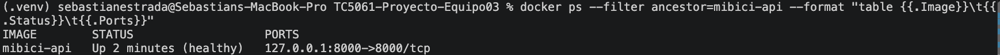

#### Docker o Podman

La actividad sugiere Podman. El equipo usa Docker porque es el que tienen instalado sus
integrantes, y con él se probó todo lo de esta sección. El `Dockerfile` sigue el estándar OCI, así
que Podman lo construye y lo corre igual: `make image MOTOR=podman` y `make container MOTOR=podman`,
o `podman build -t mibici-api .` y `podman run` con los mismos parámetros, pero con
`-e MLFLOW_TRACKING_URI=http://host.containers.internal:5001` y sin `--add-host`, porque Podman
define ese nombre por su cuenta.

### 3. Probar la API

| Ruta | Qué hace |
|---|---|
| `GET /health` | Estado del servicio y nombre, versión y alias de cada modelo. Responde 503 si alguno no cargó |
| `POST /predict/riesgo` | P2: probabilidad de que cada estación se quede sin bicis o sin anclajes en el siguiente bloque de 3 horas, y si llega al umbral del modelo |
| `POST /predict/demanda` | P1: viajes que se espera que salgan de cada estación en el día |
| `GET /docs` | Documentación interactiva con los esquemas de entrada y salida y un ejemplo para probar cada ruta |

Cada `POST` recibe una lista `observaciones` de 1 a 1,000 estaciones (las 484 de la red caben en
una sola petición) y responde una predicción por observación, en el mismo orden, con el nombre y la
versión del modelo que la hizo.

Verificar el estado del servicio y la versión de cada modelo cargado:

```bash
curl -s http://127.0.0.1:8000/health | python3 -m json.tool
```

```json
{
    "estado": "ok",
    "modelos": {
        "demanda": {
            "modelo": "mibici-equipo03-p1-demanda",
            "version": "1",
            "alias": "champion"
        },
        "riesgo": {
            "modelo": "mibici-equipo03-p2-riesgo",
            "version": "1",
            "alias": "champion"
        }
    }
}
```

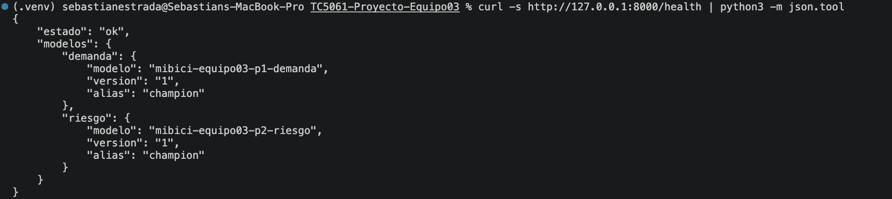

Solicitar predicciones de riesgo (`POST /predict/riesgo`):

```bash
curl -s -X POST http://127.0.0.1:8000/predict/riesgo \
  -H "Content-Type: application/json" \
  -d '{
    "observaciones": [
      {
        "flujo_neto_lag_1": -1.0,
        "flujo_neto_lag_2": 0.0,
        "salidas_lag_1": 1.0,
        "llegadas_lag_1": 0.0,
        "riesgo_semana_anterior": 0.0,
        "hora": 6,
        "dia_semana": 2,
        "festivo": false,
        "capacidad": 15
      },
      {
        "flujo_neto_lag_1": -12.0,
        "flujo_neto_lag_2": -9.0,
        "salidas_lag_1": 18.0,
        "llegadas_lag_1": 6.0,
        "riesgo_semana_anterior": 1.0,
        "hora": 18,
        "dia_semana": 4,
        "festivo": false,
        "capacidad": 15
      }
    ]
  }' | python3 -m json.tool
```

```json
{
    "predicciones": [
        {
            "riesgo": false,
            "probabilidad": 0.6436577035267755
        },
        {
            "riesgo": false,
            "probabilidad": 0.8822514297676317
        }
    ],
    "umbral": 0.8887227086000699,
    "modelo": "mibici-equipo03-p2-riesgo",
    "version": "1"
}
```

El umbral no es 0.5. Al entrenar se elige el más bajo que deja, en promedio, a lo más 10 alertas
por bloque en validación (`CAPACIDAD_REBALANCEO`), las estaciones que un camión de rebalanceo
alcanza a visitar en 3 horas. Por eso la segunda estación, con 0.882, todavía queda en
`riesgo: false`: el modelo solo alerta las de probabilidad más alta.

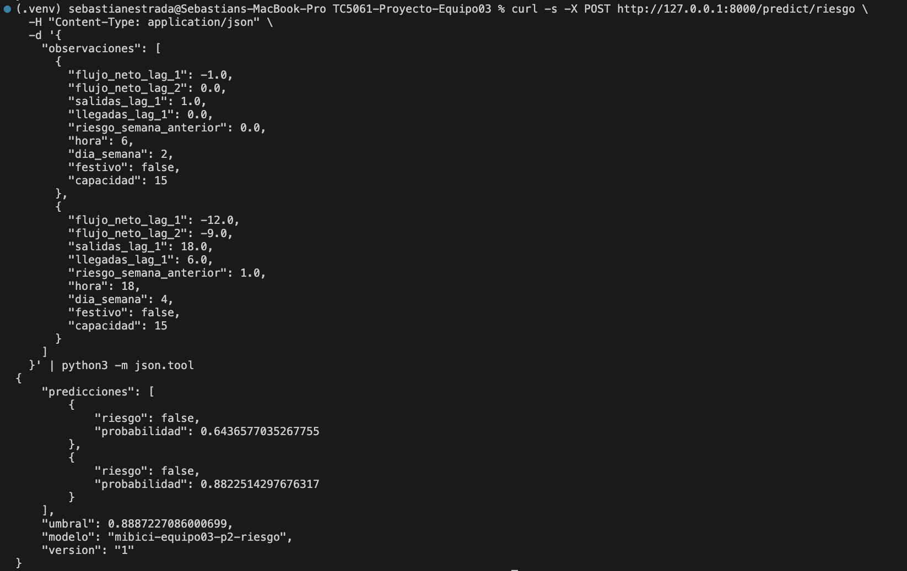

Solicitar predicciones de demanda (`POST /predict/demanda`):

```bash
curl -s -X POST http://127.0.0.1:8000/predict/demanda \
  -H "Content-Type: application/json" \
  -d '{
    "observaciones": [
      {
        "viajes_lag_1": 56.0,
        "viajes_lag_7": 54.0,
        "viajes_media_7": 50.714285714285715,
        "dia_semana": 2,
        "festivo": false,
        "capacidad": 15
      },
      {
        "viajes_lag_1": 70.0,
        "viajes_lag_7": 59.0,
        "viajes_media_7": 53.0,
        "dia_semana": 3,
        "festivo": false,
        "capacidad": 15
      },
      {
        "viajes_lag_1": 61.0,
        "viajes_lag_7": 71.0,
        "viajes_media_7": 53.285714285714285,
        "dia_semana": 4,
        "festivo": false,
        "capacidad": 15
      }
    ]
  }' | python3 -m json.tool
```

```json
{
    "predicciones": [
        {
            "viajes": 55.81184431727423
        },
        {
            "viajes": 62.14985447563778
        },
        {
            "viajes": 59.91266413835607
        }
    ],
    "modelo": "mibici-equipo03-p1-demanda",
    "version": "1"
}
```

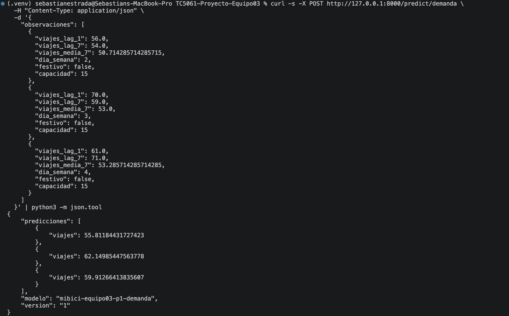

Con los mismos datos (`data_version` `4ab2182e7493`), las respuestas no cambian de computadora:
con el Registry de la corrida oficial y con uno nuevo, hecho con `make experimentos` y
`make registry` en otra máquina, `/predict/demanda` dio los mismos 55.8, 62.1 y 59.9 viajes, y la
primera estación de `/predict/riesgo`, la misma probabilidad de 0.644.

La documentación interactiva queda disponible en http://127.0.0.1:8000/docs.

### Errores

| Código | Cuándo | Qué hacer |
|---|---|---|
| 422 | La entrada no cumple el esquema: falta un campo o sobra uno, un valor está fuera de rango (por ejemplo `dia_semana` fuera de 0 a 6, una `hora` que no empieza un bloque de 3 horas (0, 3, …, 21), `capacidad` en 0 o mayor que 100, o `riesgo_semana_anterior` distinto de 0 o 1), un número no es finito (`NaN` o `Infinity`), la lista está vacía o trae más de 1,000 observaciones | Corregir lo que indica `detail`, que dice el campo (`loc`) y la regla que no se cumplió (`msg`) |
| 503 | El modelo de esa pregunta no cargó al arrancar: el servidor de MLflow está apagado, la `MLFLOW_TRACKING_URI` no es la correcta o el Registry no tiene ese alias | Revisar los logs del contenedor (`No se pudo cargar ...`), corregir y reiniciar el contenedor. La otra pregunta sigue respondiendo; `/health` da 503 mientras falte alguno. Si el servidor está apagado, la API arranca en unos 10 segundos y responde 503, porque el `Dockerfile` limita los reintentos de MLflow (`MLFLOW_HTTP_REQUEST_MAX_RETRIES=2` y `MLFLOW_HTTP_REQUEST_TIMEOUT=10`). Si la dirección no contesta (por ejemplo, una IP equivocada), cada intento espera los 10 s del timeout y tarda más de un minuto |

Por ejemplo, con `dia_semana` en 7:

```bash
curl -s -i -X POST http://127.0.0.1:8000/predict/demanda -H "Content-Type: application/json" -d '{"observaciones":[{"viajes_lag_1":56.0,"viajes_lag_7":54.0,"viajes_media_7":50.7,"dia_semana":7,"festivo":false,"capacidad":15}]}'
```

```
HTTP/1.1 422 Unprocessable Content
...
{"detail":[{"type":"less_than_equal","loc":["body","observaciones",0,"dia_semana"],"msg":"Input should be less than or equal to 6","input":7,"ctx":{"le":6}}]}
```

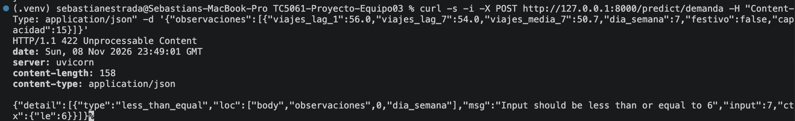

La salida también se valida: `probabilidad` y `umbral` deben estar entre 0 y 1, y `viajes` debe
ser un número finito. Si el modelo produjera otro valor, la API responde 500 en lugar de regresarlo.
`tests/api/` lo prueba con modelos falsos que dan una probabilidad de 1.5 y viajes infinitos.

### Opción elegida para el modelo: el Registry al arrancar

De las dos opciones de la actividad, la API **carga el modelo del Model Registry al arrancar**, con
`MLFLOW_TRACKING_URI` apuntando al servidor de MLflow. `MODELO_URI` (P2) y `MODELO_URI_P1` (P1)
indican el modelo por nombre y alias; por defecto, `models:/mibici-equipo03-p2-riesgo@champion` y
`models:/mibici-equipo03-p1-demanda@champion`. `cargar_modelo()` resuelve el alias a una versión,
carga esa versión y la reporta en `/health` y en cada respuesta.

Por qué:

- **La misma imagen sirve cualquier versión.** Promover un modelo nuevo es mover el alias
  `champion` con `make registry` y reiniciar el contenedor, sin reconstruir la imagen (ver
  [¿Por qué aliases y no etapas?](#model-registry)).
- **Cada predicción es rastreable.** La respuesta dice el modelo y la versión, y la versión guarda
  en el Registry su run de origen, el commit y la versión de los datos.
- **La imagen es más ligera.** No trae datos ni modelos: usa `mlflow-skinny` y solo las
  dependencias de inferencia.

El costo es que el contenedor necesita al servidor de MLflow al arrancar; si no lo alcanza, la
pregunta afectada responde 503. Y el modelo queda fijo hasta reiniciar: mover el alias no cambia el
que ya está cargado.

**La alternativa: empaquetar el modelo en la imagen.** `MODELO_URI` también acepta la ruta de una
carpeta con un modelo de MLflow, así que se puede descargar del Registry, copiarlo en la imagen y
apuntar `MODELO_URI` a esa carpeta (o construir la imagen con `mlflow models build-docker`). El
contenedor ya no depende del servidor, pero cada versión nueva obliga a reconstruir la imagen. El
job `image` del CI usa esta vía: monta modelos de prueba como carpetas para probar la imagen sin un
servidor de MLflow.

### Estrategia de despliegue: inferencia en tiempo real

Huyen (2022, cap. 7) distingue la **predicción por lotes**, que se calcula cada cierto tiempo y se
guarda para consultarla después, de la **predicción en línea**, que se calcula en el momento en que
se pide. La API es inferencia en tiempo real: cada petición responde con el modelo cargado en
memoria.

**P2 necesita tiempo real.** El rebalanceo se decide al empezar cada bloque de 3 horas, y varias
de sus variables son el flujo de los bloques que acaban de terminar (`flujo_neto_lag_1`,
`salidas_lag_1`, `llegadas_lag_1`). Esos datos no existen hasta que cierra el bloque, así que la
predicción no se puede calcular con anticipación: al cerrar cada bloque se manda una sola petición
con las 484 estaciones y se eligen las que hay que visitar. Un lote nocturno predeciría con datos
de un día antes.

**P1 podría ir por lotes.** La demanda del día se calcula con lo que ya se sabe al empezar el día
(viajes de ayer, del mismo día de la semana anterior y la media de 7 días). Un proceso cada
madrugada podría predecir las 484 estaciones de una vez y guardar el resultado, por ejemplo con
`mlflow models predict` sobre un CSV. Se sirve en la misma API para tener un solo servicio, con el
mismo mecanismo de carga y la misma validación, pero si solo se consultara una vez al día, el lote
sería la opción más simple.

**Referencia:** Huyen, C. (2022). *Designing machine learning systems: An iterative process for
production-ready applications*. O'Reilly Media.

## Monitoreo, drift y A/B testing

Esta sección es de la entrega 5 y solo trabaja con P1 (demanda por estación). La ingesta trae
hasta octubre de 2026, pero los experimentos leen hasta `FECHA_FIN`. Así, los meses posteriores
hacen de "producción": datos que el champion nunca vio.

### Periodos y por qué

Todos se definen en `mi_bici/config.py`:

| Periodo | Fechas | Para qué |
|---|---|---|
| Referencia (`PERIODO_REFERENCIA`) | `FECHA_INICIO` (octubre de 2025) al 31 de julio de 2026 | Lo que vio el champion de P1 al entrenar (112,084 filas de estación y día) |
| Actual (`PERIODO_ACTUAL`) | 1 de agosto al 31 de octubre de 2026 | Lo que llegó después, como si fuera producción (42,858 filas) |
| Reentrenamiento | `FECHA_INICIO` al 30 de septiembre de 2026 | Ventana del challenger: la del champion más agosto y septiembre |
| A/B (`CORTE_AB`) | 1 al 31 de octubre de 2026 | Un mes que ninguna de las dos versiones vio |

Los periodos no se traslapan, y por eso el A/B es justo: ni el champion ni el challenger
entrenaron con octubre. La demanda diaria se calcula una sola vez antes de separar los periodos,
así que los rezagos del 1 de agosto salen de finales de julio.

### Cómo se corre

Con el [servidor de tracking](#servidor-de-tracking-de-mlflow) arriba, el `.env` cargado, los
datos al día (`make data`) y el champion de P1 en el Registry (`make registry`):

```bash
make drift        # reporte de Evidently y evolución por mes, registrado en MLflow
make reentrenar   # P1 reentrenado hasta el 30 de septiembre, registrado como challenger
make ab-test      # A/B offline de octubre entre champion y challenger
make ab-test ARGS=--promover   # lo mismo, y si la regla lo indica mueve los aliases
```

| Comando | Qué hace |
|---|---|
| `make drift` (`mi_bici/monitoreo.py`) | Agrega a cada fila la predicción del champion y corre `DataDriftPreset` y `DataSummaryPreset` de Evidently entre la referencia y el periodo actual. Después repite el drift mes por mes y calcula el MAE del champion y del baseline en cada mes. Todo queda en un run `P1-monitoreo` con `stage_of_work=monitoring` |
| `make reentrenar` (`mi_bici/modeling/reentrenar.py`) | Copia el estimador del champion con los mismos hiperparámetros y lo ajusta con la ventana nueva. Lo registra como nueva versión con el alias `challenger`. El champion no se mueve |
| `make ab-test` (`mi_bici/ab_testing.py`) | Las dos versiones predicen las mismas filas de octubre. Compara MAE, RMSE y R² con el baseline como referencia y aplica la regla de decisión. Todo queda en un run `P1-ab-test` con la decisión en la etiqueta `decision` |

Evidently compara las variables numéricas con la distancia de Wasserstein normalizada y las
categóricas (`dia_semana` y `festivo`) con la distancia de Jensen-Shannon. Con más de 1,000 filas,
ese es su criterio por defecto: una columna tiene drift si la distancia es de 0.1 o más.

### Dónde quedan los reportes

| Archivo | Contenido |
|---|---|
| `reports/evidently/p1_drift.html` | Reporte interactivo de Evidently: drift y distribución de cada variable |
| `reports/evidently/p1_drift.csv` | Variable, método, distancia, umbral y si tiene drift |
| `reports/evidently/p1_por_mes.csv` | Por mes: filas, `drift_share`, columnas con drift, MAE del champion y del baseline, la alerta de drift y si se reentrena |
| `reports/evidently/p1_por_mes.png` | Gráfica de `drift_share` por mes con la alerta, y del MAE con el límite para reentrenar |
| `reports/ab_testing/p1_ab.csv` | MAE, RMSE y R² del champion, del challenger y del baseline en octubre |

Los mismos archivos quedan como artefactos de sus runs en MLflow. El run del A/B guarda además
`data/decision.json` con Δ, intervalo, p-valor y decisión. El reporte de la entrega, con las
cifras de la corrida oficial, está en `reports/TC5061_Drift_ABTest_Equipo03.pdf`.

### Regla de decisión del A/B

La diferencia es MAE del champion menos MAE del challenger, así que es positiva cuando el
challenger se equivoca menos. **El challenger se promueve solo si se cumplen las dos condiciones:**

1. El límite inferior del intervalo bootstrap de 95 % de esa diferencia es mayor que 0. Son 2,000
   réplicas que remuestrean estaciones completas.
2. El Wilcoxon pareado sobre el MAE de cada estación da p < 0.05 (`ALFA_AB`).

Las dos pruebas usan la estación como unidad y no la fila. Los días de una misma estación se
parecen entre sí, y contarlos como observaciones independientes daría un intervalo más angosto y
un p-valor más chico de lo que son. La salida también separa la diferencia en días hábiles y en
fin de semana.

`make ab-test` solo informa la decisión. Los aliases se mueven únicamente con `ARGS=--promover`:
el challenger pasa a `champion` y la versión anterior queda como `challenger`, lista para
regresar a ella. Como la API carga `@champion`, la nueva versión entra al reiniciar el
contenedor, sin reconstruir la imagen.

### A/B en línea con la API

El A/B de arriba es offline: las dos versiones predicen un mes histórico. En producción se haría
así:

1. **Asignar estaciones al azar.** Al inicio de la prueba, cada estación se asigna a una versión
   con una semilla fija, por ejemplo la mitad a cada una y estratificando por nivel de demanda.
   La asignación se hace por estación y no por petición: así cada estación tiene siempre la misma
   versión, y la unidad de análisis es la misma que en el A/B offline.
2. **Servir las dos versiones.** La API carga `@champion` y `@challenger`. Según la estación de
   cada fila, responde con una u otra y registra la versión, la predicción y la fecha.
3. **Medir con los datos reales.** Los viajes de cada día se conocen al día siguiente. Se junta la
   predicción con el valor real y se calcula el MAE por estación.
4. **Decidir con la misma regla.** Tras un periodo fijado de antemano (por ejemplo, 4 semanas para
   cubrir varios días de cada tipo), se aplican el intervalo bootstrap por estación y el Wilcoxon.
   El periodo no se acorta aunque los resultados se vean claros antes.

### Ciclo de entrenamiento continuo (CT)

Cada mes, `make drift` compara el último mes con la referencia y `evaluar_por_mes` aplica dos reglas
de `config.py`:

| Regla | Condición | Para qué |
|---|---|---|
| `alerta_drift` | `drift_share >= UMBRAL_DRIFT_SHARE` (0.5), es decir, al menos 4 de las 8 columnas con drift | Alerta temprana: avisa que cambió la demanda. Se mide antes de tener los valores reales |
| `reentrenar` | MAE del champion en el mes > `mae_referencia * (1 + TOLERANCIA_MAE_P1)`, con tolerancia de 15 % (6.16 viajes en la corrida oficial) | Decide. El drift no implica que el modelo falle: agosto tiene drift de 0.625 y el menor error (MAE 4.67), y septiembre no tiene drift pero el MAE sube a 6.42 |

El 0.5 es el valor por defecto de `DataDriftPreset`. De las 8 columnas, 3 son de calendario o catálogo
(`dia_semana`, `festivo` y `capacidad`) y pueden moverse sin que cambie el comportamiento. Con 0.5, la
alerta solo salta cuando se mueven las variables de demanda, el objetivo y la predicción. Las dos
reglas quedan en las columnas `alerta_drift` y `reentrenar` de `reports/evidently/p1_por_mes.csv`.

**`make ct` encadena el ciclo** (`mi_bici/ct.py`, #190):

1. Corre el monitoreo y lee la columna `reentrenar` de la tabla mensual.
2. Si algún mes la activa, reentrena el `@champion` hasta el día antes de `CORTE_AB` y lo registra
   como `@challenger`. Si el `@challenger` vigente ya tiene el mismo `source_version`, `fecha_fin` y
   `data_version`, lo reutiliza en lugar de registrar otra versión igual.
3. Corre el A/B offline sobre octubre.
4. Solo con `PROMOVER=1` y si el A/B lo aprueba, mueve `@champion` a la versión nueva y deja la
   anterior en `@challenger`.

```bash
make ct              # monitorea, reentrena si hace falta y corre el A/B, sin mover @champion
make ct PROMOVER=1   # lo mismo, y promueve si el A/B lo aprueba
```

Cada etapa deja su run en MLflow. El run final `P1-ct` (`stage_of_work=ct`) guarda la decisión
(`sin_reentrenamiento`, `mantener`, `aprobado_sin_promover` o `promovido`), el motivo, los `run_id`
de cada etapa y `data/decision_ct.json`. Los archivos intermedios van a `reports/ct/`, que no se
versiona, para no sobrescribir la evidencia oficial de `reports/evidently/` y `reports/ab_testing/`.
Con los datos actuales el disparador se activa en septiembre y octubre, y el A/B mantiene al
champion (p = 0.198). Programar `make ct` cada mes, cuando MiBici publica datos nuevos, queda como
siguiente paso. Las cifras por mes y la justificación están en el reporte PDF de la entrega 5.

**Referencia:** Huyen, C. (2022). *Designing machine learning systems*, cap. 8. O'Reilly Media.

## Operación con Compose, CI/CD y pruebas de carga

Esta sección es de la entrega 6. El sistema son dos servicios de Docker Compose (proyecto
`mibici`): `mlflow`, con el Tracking y el Model Registry, y `api`, la API de la
[entrega 4](#despliegue-de-la-api-con-docker), que sirve los `@champion` de P1 y P2. Se levanta con
un solo comando, el CI lo prueba completo en cada PR y la imagen se publica en GitHub Container
Registry con cada merge a `main`.

| Paso de la entrega | Dónde | PR |
|---|---|---|
| MLflow y la API con un solo comando | `docker-compose.yml` y `make sistema` | [#170](https://github.com/mna-mlops-tc5061-03/TC5061-Proyecto-Equipo03/pull/170) |
| El sistema completo en el CI | job `compose` de `.github/workflows/ci.yml` | [#171](https://github.com/mna-mlops-tc5061-03/TC5061-Proyecto-Equipo03/pull/171) |
| CI con push a `main` y publicación en GHCR | jobs `publicar` y `resumen` | [#175](https://github.com/mna-mlops-tc5061-03/TC5061-Proyecto-Equipo03/pull/175) |
| Escenario de Locust | `mi_bici/carga/locustfile.py` y `escenario.py` | [#173](https://github.com/mna-mlops-tc5061-03/TC5061-Proyecto-Equipo03/pull/173) |
| Un hilo de OpenMP por predicción | `OMP_NUM_THREADS=1` en la API | [#179](https://github.com/mna-mlops-tc5061-03/TC5061-Proyecto-Equipo03/pull/179) |
| CPU y memoria durante la prueba | `mi_bici/carga/recursos.py` y `make carga` | [#180](https://github.com/mna-mlops-tc5061-03/TC5061-Proyecto-Equipo03/pull/180) |
| Costo por inferencia y gráficas | `mi_bici/carga/finops.py` y `make finops` | [#181](https://github.com/mna-mlops-tc5061-03/TC5061-Proyecto-Equipo03/pull/181) |
| Pruebas de carga, recursos y costo | `tests/carga/` | [#182](https://github.com/mna-mlops-tc5061-03/TC5061-Proyecto-Equipo03/pull/182) |
| Corrida oficial | `reports/carga/` y `reports/figures/semana10/` | [#183](https://github.com/mna-mlops-tc5061-03/TC5061-Proyecto-Equipo03/pull/183) |
| Instrucciones y reporte | Esta sección y `reports/TC5061_Operacion_FinOps_Equipo03.pdf` | [#184](https://github.com/mna-mlops-tc5061-03/TC5061-Proyecto-Equipo03/pull/184), [#185](https://github.com/mna-mlops-tc5061-03/TC5061-Proyecto-Equipo03/pull/185) |

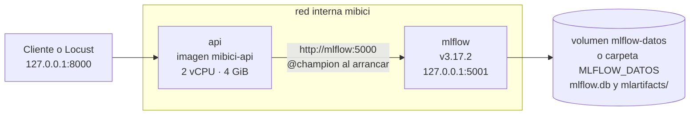

- **Red:** los dos servicios están en la red interna `mibici`, y la API llama a MLflow por el
  nombre del servicio (`http://mlflow:5000`). MLflow arranca con `--allowed-hosts` para aceptar ese
  nombre.
- **Volumen:** el Registry vive en el volumen `mlflow-datos`, o en una carpeta del host si se
  define `MLFLOW_DATOS`.
- **Orden de arranque:** la API arranca hasta que MLflow está sano (`depends_on: service_healthy`),
  porque carga los modelos al arrancar.

### Requisitos

- Docker con Compose v2 (o Podman con `podman-compose`, ver abajo), con **al menos 2 CPU** para el
  motor: la API está limitada a 2 vCPU y `make sistema` falla si Docker tiene menos.
- Un Registry con P1 y P2 en `@champion`. Si falta alguno, la API no queda sana y `make sistema`
  falla.

### Primera vez: llenar el Registry

```bash
cp .env.example .env
```

Hay dos caminos:

1. **Restaurar el paquete del equipo** (así se hizo la corrida oficial). Pon la carpeta con
   `mlflow.db` y `mlartifacts/` en `mlflow_compose/` y define en el `.env`:

   ```bash
   MLFLOW_DATOS=./mlflow_compose
   ```

2. **Desde cero**, con el MLflow del compose y los datos procesados (`make data`):

   ```bash
   docker compose up -d --wait mlflow   # solo MLflow
   make experimentos registry           # entrena y registra P1, P2 y P3 con @champion
   ```

   El `.env.example` ya apunta a `127.0.0.1:5001`, así que `make experimentos` registra en ese
   MLflow. Como en la [corrida completa](#corrida-completa-de-la-entrega), el repositorio debe
   estar sin cambios sin guardar.
   Este camino entrena las 18 corridas de la entrega, así que tarda; la corrida oficial usó el paquete del equipo.

### Levantar y apagar

```bash
make sistema         # docker compose up -d --build --wait: construye, levanta y espera a que los dos estén healthy
make sistema-abajo   # apaga el sistema
```

| Servicio | URL | Healthcheck |
|---|---|---|
| API | http://127.0.0.1:8000 | `GET /health` da 200 solo con P1 y P2 cargados |
| MLflow | http://127.0.0.1:5001 | `GET /health` cada 5 s, con `start_period` de 300 s porque la primera vez crea las tablas del Registry |

Los puertos se publican solo en `127.0.0.1`. La API se prueba igual que en
[Probar la API](#3-probar-la-api).

| Variable del `.env` | Por defecto | Para qué |
|---|---|---|
| `MLFLOW_PUERTO` | `5001` | Puerto de MLflow en el host |
| `API_PUERTO` | `8000` | Puerto de la API en el host |
| `MLFLOW_DATOS` | volumen `mlflow-datos` | Carpeta con un Registry existente |
| `MODELO_URI`, `MODELO_URI_P1` | `@champion` de P2 y P1 | Servir otra versión, como en la [entrega 4](#2-construir-y-correr-el-contenedor) |
| `API_CPUS` | `2` | Límite de CPU de la API: el tamaño de la instancia del análisis FinOps |
| `API_MEMORIA` | `4g` | Límite de memoria de la API |

**Podman:** `make sistema MOTOR=podman` usa `podman-compose`.

### Pipeline de CI/CD

`.github/workflows/ci.yml` corre con cada PR a `main` y con cada push a `main` (el merge). En un PR,
un push nuevo cancela la corrida anterior.

| Job | PR | Push a `main` | Qué valida |
|---|---|---|---|
| `pipeline` (matriz: `lint`, `test`, `security`) | ✓ | ✓ | `make lint`, `make test` y `make security` en paralelo, con Python 3.13 y caché de pip |
| `image` | ✓ | ✓ | Construye la imagen con `make image` y prueba `/health` y cada `/predict` con modelos de prueba |
| `compose` | ✓ | ✓ | Levanta MLflow y la API con Compose, registra modelos de prueba con el alias `champion` y revisa que la API los cargue del Registry y responda |
| `publicar` | «skipped» | ✓ si todo pasó | Publica la imagen en GHCR con las etiquetas `sha-<commit>` y `latest`, con caché de capas (`type=gha`) |
| `resumen` | ✓ | ✓ | Escribe en la página de la corrida el resultado de cada job y la imagen publicada |

La imagen publicada está en
[GHCR](https://github.com/orgs/mna-mlops-tc5061-03/packages/container/package/mibici-api):

```bash
docker pull ghcr.io/mna-mlops-tc5061-03/mibici-api:latest
```

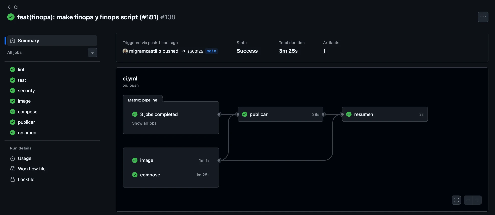

### Pruebas de carga y FinOps

Con el sistema arriba (`make sistema`):

```bash
make carga    # Locust: 10, 50, 100 y 200 usuarios, 60 s por escalón, y CPU y memoria con docker stats
make finops   # tablas por escalón, costo por inferencia y las tres gráficas
```

| Comando | Qué genera | Dónde |
|---|---|---|
| `make carga` | CSV de Locust, `locust.html`, `recursos.csv` y `maquina.json` | `reports/carga/` |
| `make finops` | `escalones.csv` y `finops.csv` | `reports/carga/` |
| `make finops` | `latencia_carga.png`, `rps_y_error_carga.png` y `recursos_carga.png` | `reports/figures/semana10/` |

Para probar otra API se cambia `HOST_CARGA`. Cada usuario simula a alguien de la operación de
MiBici: casi siempre consulta una estación de P1 o de P2, a veces manda el lote de las 470
estaciones y de vez en cuando revisa `/health`. Una petición falla si no responde 200 o no trae una
predicción por observación.

### Cifras de la corrida oficial

Corrida del 22 de noviembre de 2026 (#167, PR #183), commit `ab60f25`, con la API limitada a
2 vCPU y 4 GiB. Hubo 0 fallas en 20,782 peticiones.

| Usuarios | RPS | p50 | p95 | Error | CPU de la API (media) |
|---|---|---|---|---|---|
| 10 | 9.9 | 13 ms | 29 ms | 0 % | 12 % |
| 50 | 45.9 | 8 ms | 26 ms | 0 % | 27 % |
| 100 | 94.4 | 7 ms | 27 ms | 0 % | 42 % |
| 200 | 189.6 | 12 ms | 70 ms | 0 % | 87 % |

Con una AWS EC2 t3.medium (2 vCPU y 4 GiB) a $0.0416 por hora, el costo es
**$5.78 × 10⁻⁷ por 1,000 predicciones** a plena capacidad y **$0.236 por 1,000** con la demanda
real de MiBici (126,900 predicciones al mes), porque casi todo el tiempo la instancia está
ociosa.

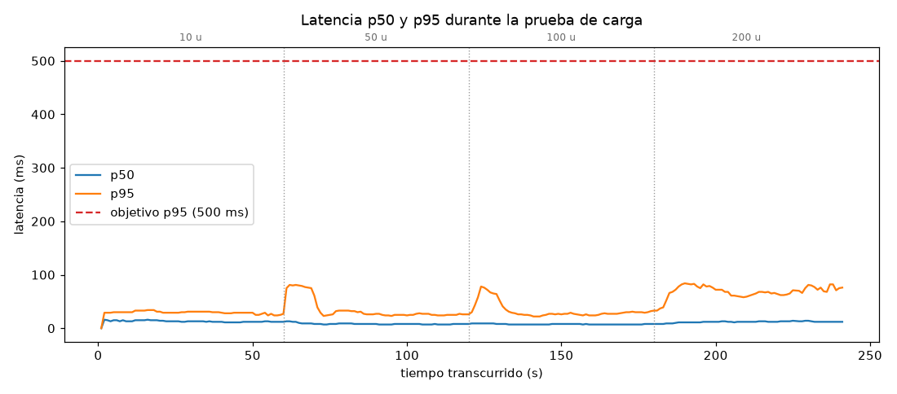

El análisis completo, con las gráficas interpretadas y las optimizaciones, está en
`reports/TC5061_Operacion_FinOps_Equipo03.pdf`.

## Pruebas y chequeos

Todo se corre desde la raíz del repositorio con el entorno activado. Ninguno necesita el servidor
de MLflow ni el `.env`:

```bash
make test            # las 340 pruebas de tests/
make test-fast       # las mismas sin las 15 lentas, que registran runs en un MLflow temporal
make validar-datos   # integridad y drift de los datos procesados con DeepChecks
make security        # bandit sobre mi_bici/ y pip-audit sobre requirements.txt y requirements-api.txt
make lint            # formato y estilo con ruff, también de tests/
```

`make validar-datos` usa los datos procesados, así que antes hay que correr la ingesta con
`make data`.

| Paso de la entrega | Dónde | PR |
|---|---|---|
| Pruebas unitarias con casos normales y límite | `tests/` | [#93](https://github.com/mna-mlops-tc5061-03/TC5061-Proyecto-Equipo03/pull/93), [#95](https://github.com/mna-mlops-tc5061-03/TC5061-Proyecto-Equipo03/pull/95) |
| Reproducibilidad del entrenamiento | `tests/modeling/test_reproducibilidad.py` | [#94](https://github.com/mna-mlops-tc5061-03/TC5061-Proyecto-Equipo03/pull/94) |
| Validación de datos con DeepChecks | `mi_bici/validacion.py` y `make validar-datos` | [#90](https://github.com/mna-mlops-tc5061-03/TC5061-Proyecto-Equipo03/pull/90), [#91](https://github.com/mna-mlops-tc5061-03/TC5061-Proyecto-Equipo03/pull/91) |
| El repositorio no expone credenciales ni datos | `.gitignore`, `.env` y `tests/test_repositorio.py` | [#96](https://github.com/mna-mlops-tc5061-03/TC5061-Proyecto-Equipo03/pull/96) |
| Análisis de seguridad del código y las dependencias | `make security` y el CI | [#89](https://github.com/mna-mlops-tc5061-03/TC5061-Proyecto-Equipo03/pull/89), [#100](https://github.com/mna-mlops-tc5061-03/TC5061-Proyecto-Equipo03/pull/100) |
| Pruebas en su carpeta y con un solo comando | `tests/`, ordenada como `mi_bici/`, y `make test` | [#93](https://github.com/mna-mlops-tc5061-03/TC5061-Proyecto-Equipo03/pull/93) |

### Pruebas con PyTest

`tests/` sigue la estructura de `mi_bici/`: lo de `mi_bici/modeling/` se prueba en `tests/modeling/`
y lo de `mi_bici/api/` en `tests/api/`. `tests/conftest.py` arma viajes y estaciones sintéticos con
el formato de la ingesta y con casos límite a propósito (una estación con pocos días de historia,
otra con capacidad 0 y viajes que cruzan el corte de prueba), así que ninguna prueba usa datos de
MiBici y todas corren en el CI.

| Archivo | Qué prueba | Pruebas |
|---|---|---|
| `test_dataset_cleaning.py` | Limpieza de la ingesta: quita `viaje_id` repetidos, viajes de menos de 2 minutos que regresan a la misma estación, duraciones negativas y viajes de más de 12 horas | 4 |
| `test_dataset_date_parsing.py` | Fechas en los formatos del portal. Límite: serie vacía, nulos, texto inválido (también como primer valor) y que no confunda el día con el mes | 11 |
| `test_dataset_manifest.py` | Versión de los datos: el hash cambia si cambia un valor y no depende del orden de las filas ni de los archivos | 5 |
| `test_features.py` | Variables de P1, P2 y P3. Límite: festivos, día sin viajes, flujo justo en el umbral, estación sin capacidad o con pocos días, y que ninguna use información del día que se predice | 28 |
| `test_validacion.py` | DeepChecks con datos sintéticos: detecta nulos, duplicados, una variable desplazada y un cambio en la tasa del objetivo, y el resumen no copia filas y dice si la tabla pasa | 14 |
| `test_repositorio.py` | Que no se versionen credenciales (también usuario y contraseña dentro de una URL), `.env`, datos, bases, modelos ni las salidas de `make ct` | 31 |
| `modeling/test_base.py` | Registro común de cada run: catálogo, hiperparámetros y modelo desconocido | 5 |
| `modeling/test_evaluate.py` | Métricas por tarea. Límite: ningún bloque en riesgo y un solo grupo | 4 |
| `modeling/test_p1.py`, `test_p2.py` y `test_p3.py` | Modelos de cada pregunta: escalado, balanceo, umbral de P2 y estabilidad de P3 | 18 |
| `modeling/test_registry.py` | `make registry`: elige al que gana en validación y en prueba, solo con runs limpios y los mismos datos, y descarta un candidato inestable de P3 | 8 |
| `modeling/test_search.py` | Búsqueda con nested runs y `params=mejor` | 4 |
| `modeling/test_mlproject.py` | Entradas del `MLproject` con sus valores por defecto | 3 |
| `modeling/test_reproducibilidad.py` | Mismas predicciones y métricas con la misma semilla | 7 |
| `api/test_app.py` | `POST /predict/riesgo` con un modelo falso: respuesta, orden del lote y tipos de la firma; 422 por cada campo faltante, fuera de rango (incluidos el tope de `capacidad`, una `hora` que no empieza un bloque y `riesgo_semana_anterior` distinto de 0 o 1), no finito (`NaN` o `Infinity`, en cualquier campo) o extra, y por un lote vacío o de más de 1,000; 503 sin modelo y la validación de la salida | 70 |
| `api/test_demanda.py` | `POST /predict/demanda`: lo mismo para P1, incluido el 422 por un campo de P2 y el 500 si el modelo predice viajes infinitos | 50 |
| `api/test_salud.py` | `GET /health` con los dos modelos, sin ninguno y con solo uno, y que una pregunta siga respondiendo si la otra no cargó | 6 |
| `api/test_esquemas.py` | Los esquemas de P1 y P2 tienen las variables de la firma del modelo y sus ejemplos son válidos | 4 |
| `modeling/test_reentrenar.py` | El challenger es una versión nueva con los mismos hiperparámetros, sin filas de octubre, y el champion no se mueve | 2 |
| `ab_testing/test_ab_testing.py` | Regla de decisión: se promueve un challenger claramente mejor y no uno idéntico o peor. El p-valor es por estación y no por fila, el intervalo bootstrap es reproducible y más ancho al remuestrear estaciones, y los aliases solo se mueven con `--promover` | 11 |
| `carga/` | Escenario de Locust, muestreo de CPU y memoria y cálculo del costo por inferencia (#182) | 25 |
| `monitoreo/test_drift.py` | Drift con Evidently sobre datos sintéticos: marca una variable numérica o categórica desplazada y no una idéntica. Los periodos no se traslapan, no entran columnas personales y la evaluación por mes detecta el mes con drift y mayor error | 11 |
| `ct/test_ct.py` | `make ct` de punta a punta contra un Registry temporal: sin disparador no reentrena; con A/B desfavorable mantiene; sin `PROMOVER=1` nunca mueve `@champion`; con `PROMOVER=1` y A/B favorable promueve; dos corridas seguidas reutilizan el challenger; y las salidas van a `reports/ct/` | 10 |

**Reproducibilidad.** `test_reproducibilidad.py` entrena dos veces con `SEMILLA` un candidato de
cada pregunta (`hgb` de P1, `rf` de P2, y `kmeans` y `gmm` de P3) y compara las predicciones y las
métricas. En P2 compara la probabilidad, no solo la etiqueta. Como caso límite, con otra semilla
`hgb`, `rf` y `kmeans` predicen distinto, así que la semilla sí llega al modelo. En P1 se usan
12,000 filas, porque con menos de 10,000 `HistGradientBoosting` no usa la semilla y la prueba
pasaría aunque la semilla no llegara.

Los tres avisos de `make test` vienen de las dependencias, no del código del proyecto: Starlette
(el `TestClient` de las pruebas de la API), MLflow (SQLAlchemy) y DeepChecks (`pkg_resources`):

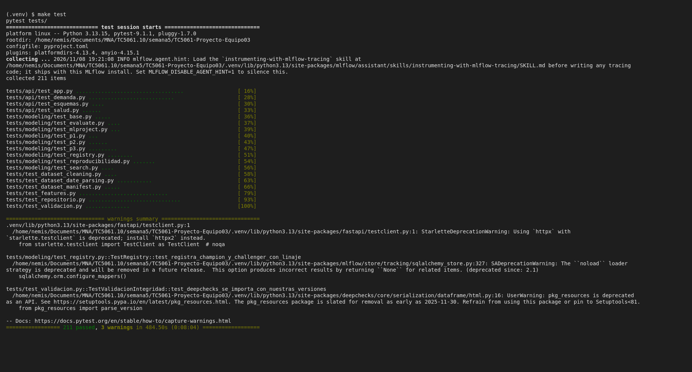

### Resultados de DeepChecks

`make validar-datos` corre lo descrito en
[Validación de datos con DeepChecks](#validación-de-datos-con-deepchecks). Con los datos de la
entrega pasan todas las condiciones:

| Tabla | Filas | Suite | Condiciones que pasan |
|---|---|---|---|
| Viajes | 4,332,379 | `data_integrity` | 9 de 9 |
| Estaciones | 484 | `data_integrity` | 9 de 9 |
| P1, `demanda_diaria` | 112,084 de entrenamiento y 28,318 de prueba | `train_test_validation` | 9 de 9 |
| P2, `etiqueta_riesgo` | 896,067 de entrenamiento y 226,930 de prueba | `train_test_validation` | 10 de 10 |

Lo que encontró:

- **Nulos:** solo `nacimiento` tiene, en 0.01 % de los viajes, lejos del 5 % permitido.
- **Duplicados:** 0.08 % de los viajes. La ingesta ya quita los `viaje_id` repetidos, así que son
  viajes distintos con los mismos datos, como dos personas que salen juntas.
- **Drift:** ninguna variable llega a 0.2. Las que más cambian son `viajes_lag_7` en P1 (0.06) y
  `capacidad` en P2 (0.05). El objetivo tampoco: 0.04 en P1 (Kolmogorov-Smirnov) y 0.01 en P2
  (V de Cramér). La media de viajes pasa de 30.27 a 29.77 y la tasa de riesgo de 4.82 % a 4.36 %.
- No hay tipos mezclados, nulos de distintas formas, fechas de prueba dentro del entrenamiento ni
  pares de columnas con correlación mayor a 0.9.

Al final de cada tabla, la terminal dice cuántas condiciones pasan y avisa de los chequeos que no
aplican, como `New Label Train Test` en P1, que es de regresión. Si alguna condición no pasa,
`make validar-datos` termina con error. La terminal solo muestra conteos y medias. Los HTML de
`reports/deepchecks/` no se versionan ni se capturan porque muestran filas de ejemplo:

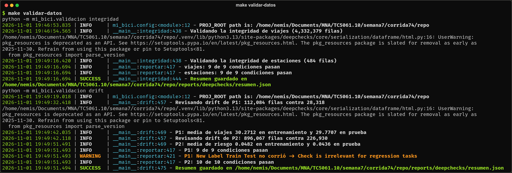

### Seguridad

**Credenciales y datos sensibles.**

- `.gitignore` deja fuera los datos de MiBici (de `data/` solo se versiona `manifest.json`),
  `mlflow.db`, `mlruns/`, `mlartifacts/`, los modelos, `.env` y sus variantes (menos
  `.env.example`) y `reports/deepchecks/`.
- La dirección del servidor de MLflow se lee de `MLFLOW_TRACKING_URI` en el `.env`.
  `.env.example` solo trae valores de ejemplo.
- La ingesta quita los identificadores del viaje y del usuario, y lo que se registra en MLflow son
  tablas agregadas.
- `tests/test_repositorio.py` lo revisa en cada PR: lee los archivos versionados con
  `git ls-files` y falla si aparece un `.env`, datos, una base, un modelo o una carpeta de MLflow,
  si `.gitignore` deja de ignorarlos o si un archivo trae algo con forma de credencial. Se probó
  agregando a la fuerza un `.env` y un Parquet: fallaron 3 pruebas.
- Se revisó una vez todo el historial de Git: ningún commit trae un `.env`, una base, datos o un
  modelo, ni algo con forma de credencial.

**bandit** revisa el código de `mi_bici/`. Antes del
[#89](https://github.com/mna-mlops-tc5061-03/TC5061-Proyecto-Equipo03/pull/89) encontró 2
hallazgos de severidad alta y 3 de baja:

| Hallazgo | Dónde | Severidad | Cómo se atendió |
|---|---|---|---|
| B324: hash MD5 | `dataset.py`, 2 veces | Alta | `hashlib.md5(usedforsecurity=False)`: es la suma de verificación del manifiesto, no protege nada, y el hash no cambia |
| B404: importar `subprocess` | `modeling/base.py` | Baja | Se omite en `[tool.bandit]` de `pyproject.toml`, porque solo avisa por el import. Las llamadas se siguen revisando |
| B603 y B607: `subprocess` con `git` | `modeling/base.py` | Baja | `# nosec B603 B607`: la llamada no usa shell y sus argumentos son fijos |

Después, en `validacion.py`, bandit marcó B105 (contraseña escrita en el código, severidad baja)
por el texto `"pasa"`, que es el estado de una condición de DeepChecks, y se marcó con
`# nosec B105`. Por eso `make security` imprime siete avisos `nosec encountered (B105), but no
failed test`, uno por cada uno de los otros textos de esa línea. No son hallazgos.

**pip-audit** revisa las dependencias de `requirements.txt`:

| Paquete | Versión | Vulnerabilidades | Cómo se atendió |
|---|---|---|---|
| `mlflow` | 3.16.1 | CVE-2026-53995, CVE-2026-115886 y CVE-2026-116691 | Se subió a 3.17.2 ([#100](https://github.com/mna-mlops-tc5061-03/TC5061-Proyecto-Equipo03/pull/100)) |
| `requests` | 2.32.5 | PYSEC-2026-2275 | Se subió a 2.33.0 ([#100](https://github.com/mna-mlops-tc5061-03/TC5061-Proyecto-Equipo03/pull/100)) |
| `setuptools` | 80.10.2 | PYSEC-2026-3447 (CVE-2026-59890) y GHSA-xmj3-9gf7-h52w | Riesgo aceptado |

Con MLflow 3.17.2, una corrida de P1 con `mlflow run` dio el mismo `data_version` y las mismas
métricas que antes.

**Riesgo aceptado en `setuptools`.** DeepChecks 0.19.1, su última versión, usa `pkg_resources`,
que necesita `setuptools<81`. Las dos vulnerabilidades no aplican a este proyecto: la primera
ocurre al armar un sdist en macOS y la segunda al instalar wheels como egg en Windows, y aquí no se
hace ninguna de las dos. `make security` las ignora con `--ignore-vuln`, que pip-audit ofrece para
vulnerabilidades que no aplican, y el motivo queda en el `Makefile`. pip-audit reporta
«3 ignored» porque su base de datos trae PYSEC-2026-3447 dos veces. `mi-bici` aparece como no
auditado porque es el paquete de este repositorio (`-e .`), que no está en PyPI; su código lo
revisa bandit.

Desde la entrega 5, `make security` también revisa `requirements-api.txt`, las dependencias de
la imagen de la API, que tienen sus propias versiones. Ahí no hay vulnerabilidades conocidas, así
que no se ignora ninguna.

bandit antes del #89, con sus 5 hallazgos y el resumen:

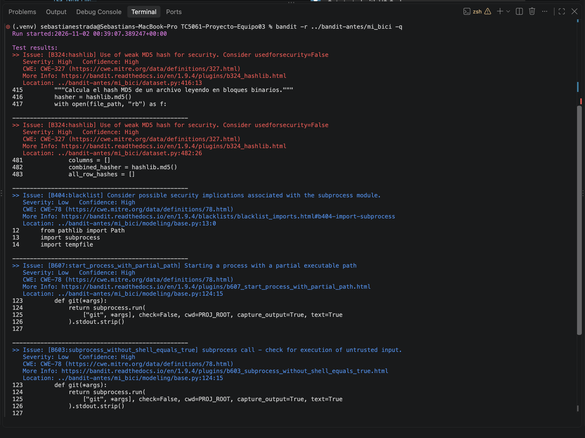

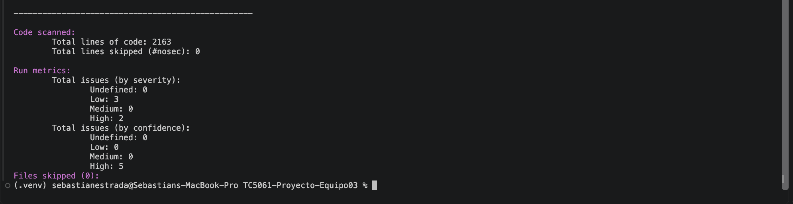

`make security` antes del #100, con bandit ya sin hallazgos y pip-audit con 5 vulnerabilidades:

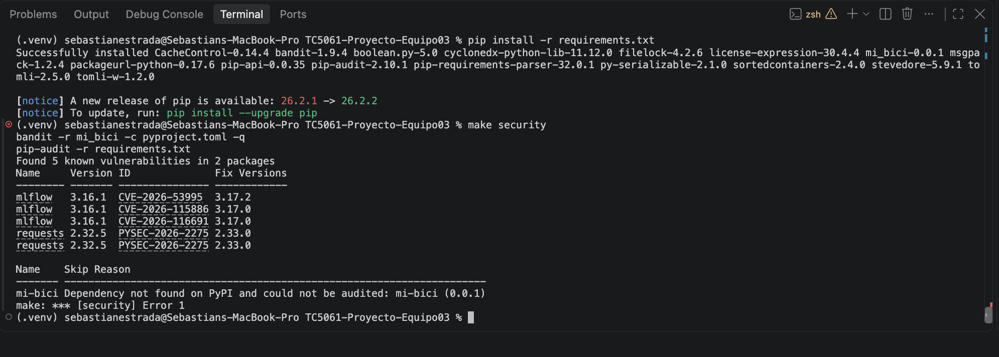

`make security` ahora:

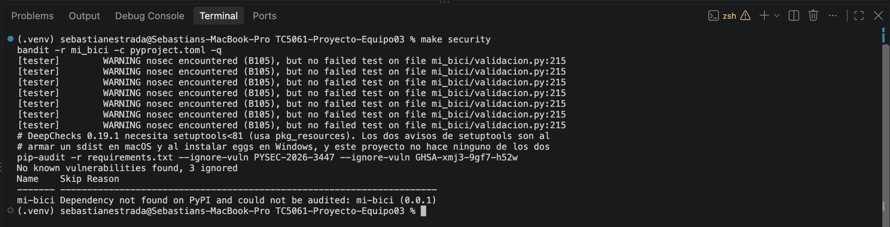

### Integración continua

Cada PR a `main` corre `make lint`, `make test` y `make security` en GitHub Actions
(`.github/workflows/ci.yml`), con un job por comando para ver por separado cuál falla. Desde la
entrega 4, el job `image` construye la imagen con `make image`, la levanta con modelos de prueba y
comprueba `/health` y cada `/predict`. Desde la entrega 6, el job `compose` prueba el sistema
completo, el CI también corre con cada push a `main` y publica la imagen en GHCR (ver
[Pipeline de CI/CD](#pipeline-de-cicd)).
`make validar-datos` no corre ahí porque necesita los datos de MiBici, que no se versionan, pero
`tests/test_validacion.py` sí, con datos sintéticos.

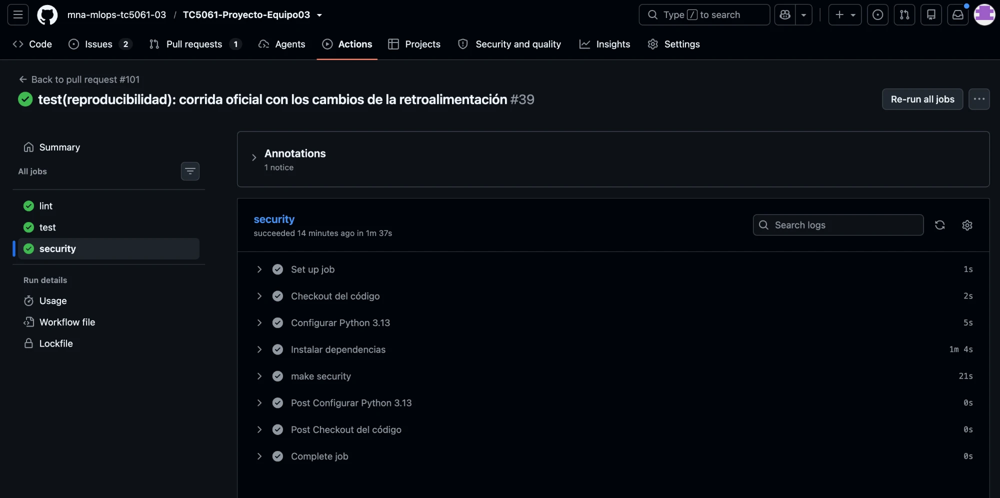

Los cuatro jobs en verde en el PR [#125](https://github.com/mna-mlops-tc5061-03/TC5061-Proyecto-Equipo03/pull/125):

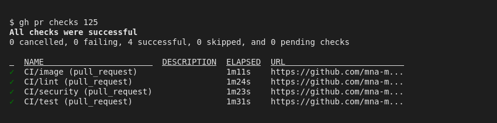

## Buenas prácticas aplicadas

| Práctica | Cómo se aplica |
|---|---|
| Estructura estándar | Plantilla de Cookiecutter Data Science |
| Datos inmutables y fuera de Git | `data/raw/` no se modifica ni se versiona; solo `data/manifest.json` |
| Reproducibilidad | Dependencias con versión fija, semilla y configuración centralizada en `config.py`, versión de datos por hash |
| Código en módulos | Los notebooks solo exploran; la lógica vive en `mi_bici/` |
| Registro de experimentos | Todos los runs se registran en MLflow con los mismos parámetros, métricas y etiquetas |
| Variables sin fuga de información | Las variables usan solo información disponible antes del momento a predecir |
| Pruebas y estilo | Pruebas unitarias en `tests/` y formato del código y de las pruebas revisado con ruff |
| Secretos fuera del código | Credenciales y URIs en `.env`, que no se versiona |
| Datos validados | DeepChecks revisa la integridad de los datos y el drift entre entrenamiento y prueba con `make validar-datos` |
| Monitoreo y reentrenamiento | Evidently mide el drift de P1 cada mes como alerta, y el reentrenamiento se decide con el MAE. Un modelo reentrenado entra a producción solo si gana un A/B con una regla fijada de antemano. `make ct` encadena el ciclo y no promueve sin `PROMOVER=1` |
| Documentación del modelo | El [Model Card](MODEL_CARD.md) documenta uso previsto, datos, métricas, limitaciones, ética y linaje de los modelos en producción |
| Chequeos de seguridad | `make security` corre bandit y pip-audit en cada PR, y `tests/test_repositorio.py` revisa que no se versionen secretos ni datos |
| Sin credenciales ni datos personales en MLflow | La ingesta elimina los identificadores del viaje y del usuario; género y año de nacimiento solo se agregan por estación; parámetros, métricas y artefactos son agregados |
| Validación en la API | Pydantic rechaza con 422 campos faltantes, extra o fuera de rango antes de llamar al modelo, y valida también la salida |
| Modelo por alias | La API carga `@champion` del Model Registry y reporta la versión en cada respuesta: promover un modelo no requiere reconstruir la imagen |
| Imagen mínima y sin privilegios | Solo las dependencias de inferencia (`requirements-api.txt`), sin datos ni `.env` (`.dockerignore`), con un usuario sin privilegios y un `HEALTHCHECK` a `/health` |
| API solo en local | `make container` y `make sistema` publican los puertos en `127.0.0.1`, no en toda la red |
| Sistema con un solo comando | `make sistema` levanta MLflow y la API con Compose y espera sus healthchecks; el CI lo prueba igual en cada PR |
| Imagen publicada solo si todo pasa | El CI publica en GHCR con push a `main` y solo si pasaron todos los jobs, etiquetada con el commit |
| Costo medido | La prueba de carga mide RPS, latencia, CPU y memoria, y `make finops` calcula el costo por inferencia con esas cifras |
| Flujo de trabajo | GitHub Flow, rama `main` protegida, Pull Requests con revisión y Conventional Commits |

## Estructura

Generada con [Cookiecutter Data Science](https://cookiecutter-data-science.drivendata.org/) 2.3.0.

```
├── mi_bici/                 # código del proyecto
│   ├── config.py            # rutas, URLs, periodo, semilla, umbrales y experimento de MLflow
│   ├── dataset.py           # ingesta: descarga, limpieza, Parquet y manifiesto
│   ├── features.py          # variables de P1, P2 y P3, sin información del futuro
│   ├── plots.py             # gráficas que se registran como artefactos
│   ├── seguimiento.py       # conexión con el servidor de tracking de MLflow
│   ├── validacion.py        # validación de los datos con DeepChecks
│   ├── monitoreo.py         # drift de P1 con Evidently y evolución mensual del drift y del MAE
│   ├── ab_testing.py        # A/B offline de P1 entre champion y challenger y regla de decisión
│   ├── ct.py                # make ct: monitoreo, reentrenamiento, A/B y promoción con PROMOVER=1
│   ├── carga/
│   │   ├── locustfile.py    # usuario de Locust: consultas de una estación, lotes de 470 y /health
│   │   ├── escenario.py     # observaciones sintéticas y escalones de la prueba
│   │   ├── recursos.py      # CPU y memoria de cada contenedor con docker stats
│   │   └── finops.py        # tablas por escalón, costo por inferencia y gráficas
│   ├── api/
│   │   ├── app.py           # API de FastAPI: /health, /predict/riesgo y /predict/demanda
│   │   └── esquemas.py      # esquemas de Pydantic de entrada y salida, con ejemplos
│   └── modeling/
│       ├── base.py          # ExperimentoBase: registro común de cada run en MLflow
│       ├── evaluate.py      # métricas por tipo de tarea (val_*, test_*, train_*)
│       ├── p1_demanda.py    # P1: catálogo de modelos, variables, evaluación y artefactos
│       ├── p2_riesgo.py     # P2: lo mismo para el riesgo por bloque
│       ├── p3_grupos.py     # P3: lo mismo para los grupos de estaciones
│       ├── registry.py      # lleva el mejor modelo de cada pregunta al Model Registry
│       ├── reentrenar.py    # reentrena el champion de P1 y lo registra como challenger
│       ├── search.py        # CLI de búsqueda de hiperparámetros con nested runs
│       └── train.py         # CLI de entrenamiento: una pregunta y un modelo por run
├── data/                    # raw, interim, processed y external. No se versiona
├── models/                  # modelos serializados. No se versionan
├── notebooks/               # exploración, con la convención 1.0-iniciales-descripcion.ipynb
├── references/              # ML Canvas, diagramas y referencias
├── reports/                 # reportes PDF de cada entrega y figures/ (capturas por semana)
│   ├── evidently/           # reporte HTML de drift de P1, tablas CSV y gráfica por mes
│   ├── ab_testing/          # tabla del A/B de P1 (p1_ab.csv)
│   ├── ct/                  # salidas intermedias de make ct. No se versiona
│   ├── carga/               # resultados de make carga y make finops (CSV, locust.html, maquina.json)
│   └── figures/semana10/    # gráficas de carga y capturas de la entrega 6
├── tests/                   # pruebas unitarias, ordenadas como mi_bici/; carga/ y ci/ (modelos falsos del CI)
├── docs/                    # documentación con mkdocs
├── Makefile                 # make data, make validar-datos, make train, make experimentos, make registry, make drift, make reentrenar, make ab-test, make ct, make test, make test-fast, make lint, make security, make api, make image, make container, make sistema, make sistema-abajo, make carga, make finops
├── docker-compose.yml       # servicios mlflow y api, red mibici, volumen mlflow-datos y healthchecks
├── .github/workflows/ci.yml # CI/CD: matriz lint, test y security, image, compose, publicar y resumen
├── Dockerfile               # imagen de la API: dependencias de inferencia, código y usuario sin privilegios
├── .dockerignore            # deja fuera de la imagen los datos, MLflow, .env, pruebas y documentación
├── MLproject                # entradas ingest, train y search de MLflow
├── MODEL_CARD.md            # ficha de los modelos en producción (uso, datos, métricas, límites y ética)
├── python_env.yaml          # entorno del MLflow Project
├── .env.example             # MLFLOW_TRACKING_URI y las variables del compose (puertos, datos, modelos y límites)
├── requirements.txt         # dependencias con versiones fijas
├── requirements-api.txt     # dependencias de la API, también con versiones fijas
└── pyproject.toml           # metadatos del paquete y configuración de ruff y bandit
```

`.gitignore` excluye los datos de MiBici, `mlflow.db`, `mlruns/`, `mlartifacts/`, `.env`, los
modelos serializados, los reportes de DeepChecks y las salidas de `make ct` (`reports/ct/`). De `data/` solo se versiona `data/manifest.json`, la versión de los datos.

## Flujo de trabajo

Seguimos [GitHub Flow](https://docs.github.com/en/get-started/using-github/github-flow):

1. Nadie trabaja directo en `main`.
2. Cada cambio sale de `main` actualizado, en su propia rama.
3. Entra a `main` solo por Pull Request, con al menos una revisión de otro integrante.

**Ramas:** `tipo/descripcion-corta`, en minúsculas y con guiones. Por ejemplo `feat/ingesta` o
`docs/readme`.

**Commits:** [Conventional Commits](https://www.conventionalcommits.org/es/v1.0.0/), con el formato
`tipo(alcance opcional): descripción corta`. Por ejemplo `feat(ingesta): manifiesto de datos` o
`docs: instalación en el README`. Si un cambio rompe algo que ya funcionaba, se marca con `!`
(`feat!: ...`) y se explica en el cuerpo del commit con `BREAKING CHANGE:`. El título del Pull
Request sigue el mismo formato.

| Tipo | Cuándo |
|---|---|
| `feat` | Funcionalidad nueva |
| `fix` | Corrección de un error |
| `docs` | Solo documentación |
| `chore` | Configuración o dependencias |
| `style` | Formato, sin cambiar la lógica |
| `refactor` | Reorganizar código sin cambiar lo que hace |
| `test` | Pruebas |
| `perf` | Mejora de rendimiento |
| `build` / `ci` | Empaquetado o integración continua |

**Docstrings:** estilo Google en español, para que todo el código se lea igual. El resumen va en
una línea, con verbo en tercera persona (Calcula, Registra, Descarga). Si hace falta, sigue un
párrafo con el porqué y las secciones `Args` y `Returns`.

```python
def metricas_regresion(y, pred) -> dict:
    """Calcula las métricas de regresión de P1.

    El MAE se lee en viajes, que es lo que el operador entiende.

    Args:
        y: Valores reales del conjunto de prueba.
        pred: Valores predichos.

    Returns:
        `test_mae`, `test_rmse` y `test_r2`.
    """
```

## Integrantes

| Integrante | Matrícula | Rol en la propuesta |
|---|---|---|
| Anaí Lael Barrera Magaña | A01797380 | Exploración de datos y README |
| Gerardo González Martínez | A01840096 | Configuración, registro común en MLflow, variables y experimento base |
| Miguel Ángel Ramírez Castillo | A01840045 | Ingesta reproducible y administración del repositorio |
| Sebastián Estrada García | A00805402 | ML Canvas, diagramas, referencias, evidencia de MLflow y documento de la propuesta |


