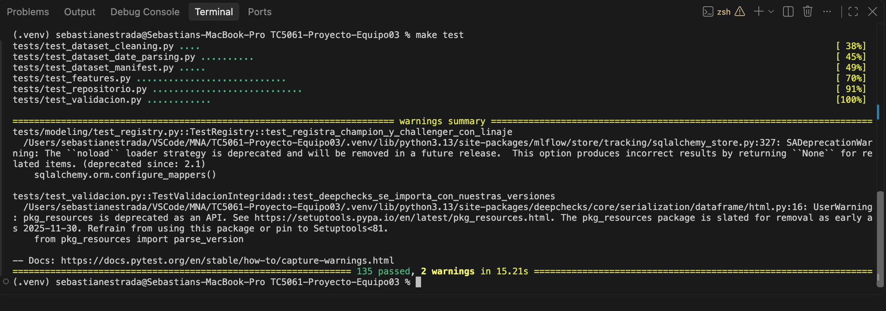
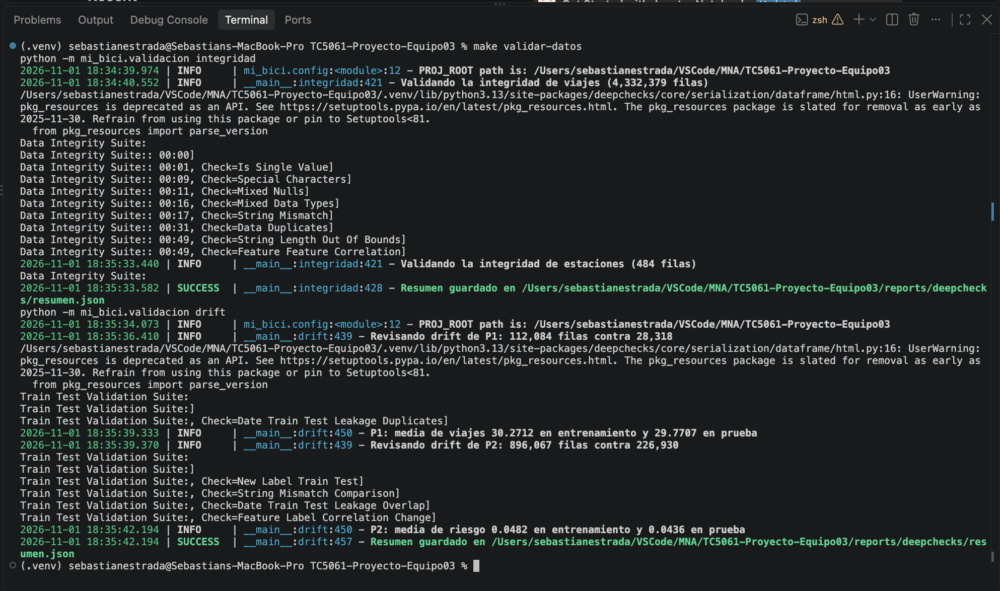
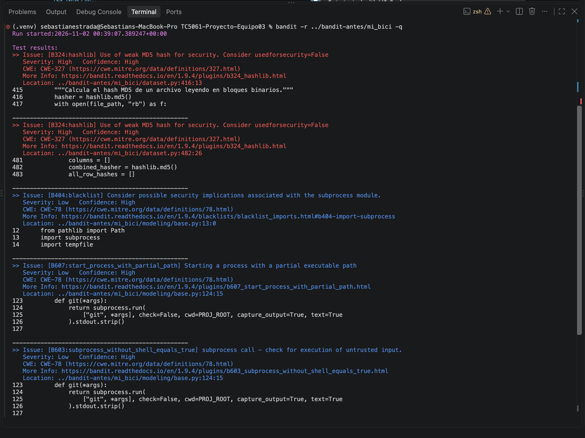
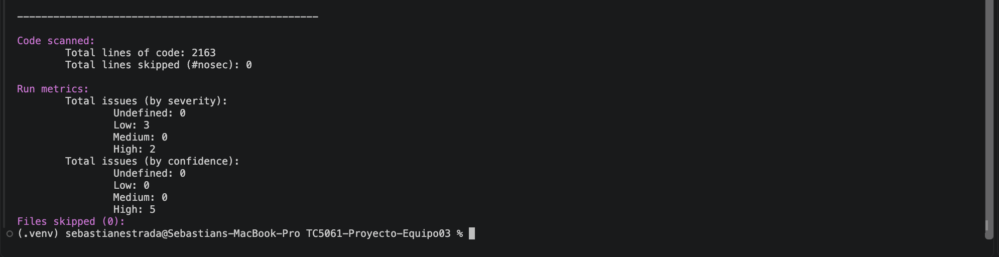
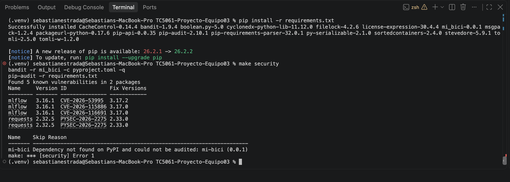
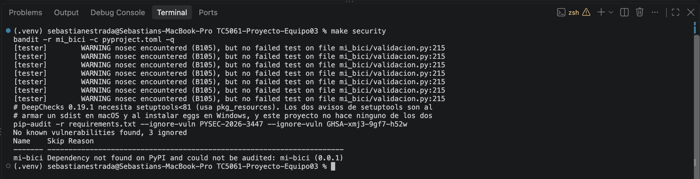
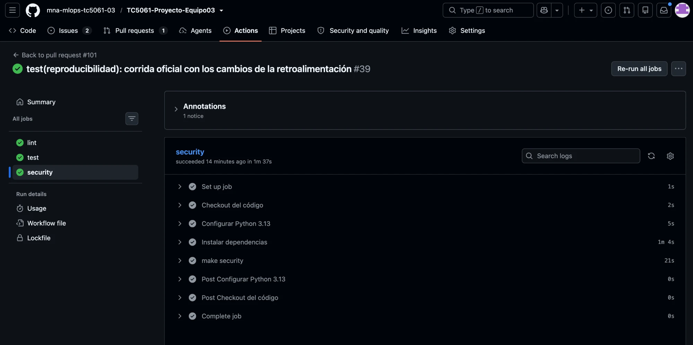

# mi_bici

<a target="_blank" href="https://cookiecutter-data-science.drivendata.org/">
    
</a>

Propuesta y base reproducible de ML para el sistema MiBici. Con los viajes que publica el
[portal de datos abiertos](https://mibici.net/es/datos-abiertos/) se responden tres preguntas de
operación: demanda por estación (regresión), riesgo de quedarse sin bicis o sin anclajes
(clasificación) y grupos de estaciones con patrones de uso parecidos (clustering).

## Preguntas

| | Pregunta | Tarea | Métrica principal |
|---|---|---|---|
| **P1** | ¿Cuántos viajes saldrán de cada estación al día siguiente? | Regresión | MAE (en viajes) |
| **P2** | ¿Qué estaciones están en riesgo de quedarse sin bicis o sin anclajes en el siguiente bloque de 3 horas? | Clasificación | Average precision |
| **P3** | ¿Qué grupos de estaciones tienen patrones de uso parecidos? | Clustering | Silhouette |

Las tres se formularon con el [Machine Learning Canvas](https://www.ownml.co/machine-learning-canvas), disponible en `references/`.

## Datos

Se usan los datos abiertos de [MiBici](https://mibici.net/es/datos-abiertos/), el sistema de bicicleta pública del Área Metropolitana de Guadalajara:

- **Viajes** (`datos_abiertos_AAAA_MM.csv`): un archivo por mes, con identificador del viaje y del usuario, género, año de nacimiento, fecha y hora de inicio y fin, y estaciones de origen y destino.
- **Estaciones** (`nomenclatura_AAAA_MM.csv`): catálogo con identificador, nombre, ubicación y capacidad de cada estación.

Se usan 12 meses, de octubre de 2025 a septiembre de 2026: 4,332,379 viajes después de la limpieza y 484 estaciones. El periodo y el corte de prueba se definen en `mi_bici/config.py`. Los archivos descargados se guardan sin modificar en `data/raw/`, y las versiones limpias, ya sin los identificadores del viaje y del usuario, en Parquet en `data/processed/`. Ninguno se versiona: se reconstruyen con la ingesta, y `data/manifest.json` registra el número de filas y el hash de los datos procesados como versión de los datos.

## Instalación

Requiere Python 3.13. Los comandos se corren desde la raíz del repositorio.

```bash
python3.13 -m venv .venv
source .venv/bin/activate
pip install -r requirements.txt
```
`requirements.txt` fija la versión exacta de cada dependencia, así que el entorno es el mismo en
cualquier computadora.

## Ejecución

El proyecto se corre como MLflow Project. Antes, con el entorno activado, se levanta el
[servidor de tracking](#servidor-de-tracking-de-mlflow) y se carga el `.env` en la terminal,
porque `mlflow run` toma `MLFLOW_TRACKING_URI` de ahí:

```bash
source .venv/bin/activate
set -a && source .env && set +a
```

Después, desde la raíz del repositorio:

```bash
mlflow run . -e ingest --experiment-name mibici-equipo03 --env-manager local
for q in p1 p2 p3; do
  mlflow run . -e train -P question=$q -P model=baseline --experiment-name mibici-equipo03 --env-manager local
done
mlflow run . -e train -P question=p1 -P model=hgb --experiment-name mibici-equipo03 --env-manager local
mlflow run . -e train -P question=p2 -P model=hgb --experiment-name mibici-equipo03 --env-manager local
mlflow run . -e train -P question=p3 -P model=kmeans --experiment-name mibici-equipo03 --env-manager local
mlflow run . -e search -P question=p1 -P model=hgb --experiment-name mibici-equipo03 --env-manager local
make registry
```

Así cada pregunta tiene su baseline y un candidato, que es lo mínimo que necesita `make registry`:
en cada pregunta registra el mejor de los candidatos que le ganan al baseline. Los demás modelos
del catálogo se corren igual, cambiando `question` y `model`.

`--experiment-name` deja cada run en el experimento que usa el código, y `--env-manager local`
usa el `.venv` activo en lugar de crear otro entorno a partir de `python_env.yaml`.

| Entrada | Parámetros | Qué hace |
|---|---|---|
| `ingest` | — | Descarga, limpia y versiona los datos (lo mismo que `make data`) |
| `train` | `question` (`p1`, `p2` o `p3`), `model` (clave del catálogo, `baseline` por defecto) y `params` (`"k=v,..."` o `mejor`, opcional) | Un run con un modelo: ajusta antes de `corte_validacion`, mide en validación y después en prueba (P3, sin etiquetas, se mide en entrenamiento) |
| `search` | `question`, `model` (`hgb` por defecto) y `grid` (`"k=v1\|v2,..."`, vacío usa la cuadrícula del catálogo) | Un run padre con un run hijo por combinación, medidos solo en validación. El padre guarda la mejor en la etiqueta `mejor_params` |

Cada pregunta tiene su catálogo de modelos en su archivo:

| Pregunta | Archivo | Modelos |
|---|---|---|
| P1 | `p1_demanda.py` | `baseline`, `hgb`, `rf` y `ridge` |
| P2 | `p2_riesgo.py` | `baseline`, `hgb`, `logreg` y `rf` |
| P3 | `p3_grupos.py` | `baseline`, `kmeans`, `birch` y `gmm` |

La mejor combinación de una búsqueda se registra como candidato con `-P params=mejor`, que toma la
etiqueta `mejor_params` de la búsqueda más reciente del mismo modelo con los mismos datos. Si no
hay búsqueda, `train` se detiene y dice cómo correrla.

### Corrida completa de la entrega

`make experimentos` lanza con `mlflow run` las 18 corridas de la entrega: por pregunta, el
baseline, los tres candidatos del catálogo, una búsqueda con nested runs y, como candidato, la mejor
combinación de esa búsqueda (`params=mejor`), sin hiperparámetros escritos a mano. Toma
`MLFLOW_TRACKING_URI` del `.env` y se detiene si no lo encuentra.

```bash
mlflow run . -e ingest --experiment-name mibici-equipo03 --env-manager local
make experimentos
make registry
```

El modelo elegido de cada pregunta en la corrida oficial (commit `46b18e1`) se reproduce con:

```bash
mlflow run . -e train -P question=p1 -P model=hgb -P params="learning_rate=0.1,max_leaf_nodes=63" --experiment-name mibici-equipo03 --env-manager local
mlflow run . -e train -P question=p2 -P model=hgb -P params="learning_rate=0.05,max_leaf_nodes=127" --experiment-name mibici-equipo03 --env-manager local
mlflow run . -e train -P question=p3 -P model=kmeans -P params="n_clusters=2" --experiment-name mibici-equipo03 --env-manager local
```

Otros comandos:

```bash
make data              # descarga, limpia y versiona los datos de MiBici
make validar-datos     # valida integridad y drift de los datos con DeepChecks
make train             # registra el baseline y los candidatos de P1, P2 y P3 sin mlflow run
make experimentos      # corre con mlflow run las 18 corridas de la entrega (usa el .env)
make registry          # registra el mejor modelo de cada pregunta con el alias champion
make test              # corre las pruebas de tests/
make test-fast         # corre las pruebas sin las lentas, que levantan MLflow
make lint              # revisa el formato del código
make security          # revisa el código con bandit y las dependencias con pip-audit
```

### Validación de datos con DeepChecks

Con los datos procesados, este comando revisa la integridad de los datos y el drift entre
entrenamiento y prueba:

```bash
make validar-datos
```

**Integridad** (`python -m mi_bici.validacion integridad`). Corre sobre los viajes y las
estaciones la suite `data_integrity` de DeepChecks con condiciones explícitas, definidas en
`config.py`: a lo más 5 % de nulos por columna, a lo más 1 % de filas duplicadas y ninguna
columna con entre 1 % y 10 % de valores de otro tipo. También revisa columnas con un solo valor,
caracteres especiales, formas distintas de nulo, variantes de un mismo texto, longitudes de texto
atípicas y columnas muy correlacionadas.

**Drift** (`python -m mi_bici.validacion drift`). Corre la suite `train_test_validation` sobre
las tablas de variables de P1 (`demanda_diaria`) y P2 (`etiqueta_riesgo` sobre
`flujo_por_bloque`), con el entrenamiento antes de `CORTE_PRUEBA` y la prueba desde esa fecha.
`FeatureDrift` marca una variable si su puntaje llega a 0.2 y `LabelDrift` marca el objetivo
desde 0.15. El resumen trae el puntaje de cada variable y la media del objetivo en cada
conjunto; en P2 es la tasa de riesgo.

Deja en `reports/deepchecks/` un HTML por tabla y `resumen.json`, con cada condición, si pasó y
por qué. La carpeta no se versiona porque el HTML muestra filas de ejemplo; el resumen solo trae
conteos y resultados. `tests/test_validacion.py` prueba la validación con datos sintéticos, así
que corre en el CI sin los datos de MiBici.

DeepChecks 0.19.1 es de diciembre de 2024 y no soporta numpy 2 ni scikit-learn 1.9.
`preparar_deepchecks()` en `mi_bici/validacion.py` agrega lo que le falta antes de importarlo.
Tres chequeos no funcionan con pandas 3, numpy 2 o scikit-learn 1.9 y se quitan de las suites,
junto con los que no aplican a estas tablas. El motivo de cada uno está en
`CHEQUEOS_QUE_SE_QUITAN` y `CHEQUEOS_DRIFT_QUE_SE_QUITAN`.

## Pruebas y chequeos

Todo se corre desde la raíz del repositorio con el entorno activado. Ninguno necesita el servidor
de MLflow ni el `.env`:

```bash
make test            # las 135 pruebas de tests/
make test-fast       # las mismas sin las 5 lentas, que registran runs en un MLflow temporal
make validar-datos   # integridad y drift de los datos procesados con DeepChecks
make security        # bandit sobre mi_bici/ y pip-audit sobre requirements.txt
make lint            # formato y estilo con ruff, también de tests/
```

`make validar-datos` usa los datos procesados, así que antes hay que correr la ingesta.

| Paso de la entrega | Dónde | PR |
|---|---|---|
| Pruebas unitarias con casos normales y límite | `tests/` | [#93](https://github.com/mna-mlops-tc5061-03/TC5061-Proyecto-Equipo03/pull/93), [#95](https://github.com/mna-mlops-tc5061-03/TC5061-Proyecto-Equipo03/pull/95) |
| Reproducibilidad del entrenamiento | `tests/modeling/test_reproducibilidad.py` | [#94](https://github.com/mna-mlops-tc5061-03/TC5061-Proyecto-Equipo03/pull/94) |
| Validación de datos con DeepChecks | `mi_bici/validacion.py` y `make validar-datos` | [#90](https://github.com/mna-mlops-tc5061-03/TC5061-Proyecto-Equipo03/pull/90), [#91](https://github.com/mna-mlops-tc5061-03/TC5061-Proyecto-Equipo03/pull/91) |
| El repositorio no expone credenciales ni datos | `.gitignore`, `.env` y `tests/test_repositorio.py` | [#96](https://github.com/mna-mlops-tc5061-03/TC5061-Proyecto-Equipo03/pull/96) |
| Análisis de seguridad del código y las dependencias | `make security` y el CI | [#89](https://github.com/mna-mlops-tc5061-03/TC5061-Proyecto-Equipo03/pull/89), [#100](https://github.com/mna-mlops-tc5061-03/TC5061-Proyecto-Equipo03/pull/100) |
| Pruebas en su carpeta y con un solo comando | `tests/`, ordenada como `mi_bici/`, y `make test` | [#93](https://github.com/mna-mlops-tc5061-03/TC5061-Proyecto-Equipo03/pull/93) |

### Pruebas con PyTest

`tests/` sigue la estructura de `mi_bici/`: lo de `mi_bici/modeling/` se prueba en
`tests/modeling/`. `tests/conftest.py` arma viajes y estaciones sintéticos con el formato de la
ingesta y con casos límite a propósito (una estación con pocos días de historia, otra con capacidad
0 y viajes que cruzan el corte de prueba), así que ninguna prueba usa datos de MiBici y todas corren
en el CI.

| Archivo | Qué prueba | Pruebas |
|---|---|---|
| `test_dataset_cleaning.py` | Limpieza de la ingesta: quita `viaje_id` repetidos, viajes de menos de 2 minutos que regresan a la misma estación, duraciones negativas y viajes de más de 12 horas | 4 |
| `test_dataset_date_parsing.py` | Fechas en los formatos del portal. Límite: serie vacía, nulos, texto inválido y que no confunda el día con el mes | 10 |
| `test_dataset_manifest.py` | Versión de los datos: el hash cambia si cambia un valor y no depende del orden de las filas ni de los archivos | 5 |
| `test_features.py` | Variables de P1, P2 y P3. Límite: festivos, día sin viajes, flujo justo en el umbral, estación sin capacidad o con pocos días, y que ninguna use información del día que se predice | 28 |
| `test_validacion.py` | DeepChecks con datos sintéticos: detecta nulos, duplicados, una variable desplazada y un cambio en la tasa del objetivo, y el resumen no copia filas | 12 |
| `test_repositorio.py` | Que no se versionen credenciales, `.env`, datos, bases ni modelos | 28 |
| `modeling/test_base.py` | Registro común de cada run: catálogo, hiperparámetros y modelo desconocido | 5 |
| `modeling/test_evaluate.py` | Métricas por tarea. Límite: ningún bloque en riesgo y un solo grupo | 4 |
| `modeling/test_p1.py`, `test_p2.py` y `test_p3.py` | Modelos de cada pregunta: escalado, balanceo, umbral de P2 y estabilidad de P3 | 18 |
| `modeling/test_registry.py` | `make registry`: elige al que gana en validación y en prueba, solo con runs limpios y los mismos datos, y descarta un candidato inestable de P3 | 8 |
| `modeling/test_search.py` | Búsqueda con nested runs y `params=mejor` | 4 |
| `modeling/test_mlproject.py` | Entradas del `MLproject` con sus valores por defecto | 3 |
| `modeling/test_reproducibilidad.py` | Mismas predicciones y métricas con la misma semilla | 6 |

**Reproducibilidad.** `test_reproducibilidad.py` entrena dos veces con `SEMILLA` un candidato de
cada pregunta (`hgb` de P1, `rf` de P2, y `kmeans` y `gmm` de P3) y compara las predicciones y las
métricas. En P2 compara la probabilidad, no solo la etiqueta. Como caso límite, con otra semilla
`rf` y `kmeans` predicen distinto, así que la semilla sí llega al modelo.

Los dos avisos de `make test` vienen de MLflow (SQLAlchemy) y de DeepChecks (`pkg_resources`), no
del código del proyecto:



### Resultados de DeepChecks

`make validar-datos` corre lo descrito en
[Validación de datos con DeepChecks](#validación-de-datos-con-deepchecks). Con los datos de la
entrega pasan todas las condiciones:

| Tabla | Filas | Suite | Condiciones que pasan |
|---|---|---|---|
| Viajes | 4,332,379 | `data_integrity` | 9 de 9 |
| Estaciones | 484 | `data_integrity` | 9 de 9 |
| P1, `demanda_diaria` | 112,084 de entrenamiento y 28,318 de prueba | `train_test_validation` | 9 de 9 |
| P2, `etiqueta_riesgo` | 896,067 de entrenamiento y 226,930 de prueba | `train_test_validation` | 10 de 10 |

Lo que encontró:

- **Nulos:** solo `nacimiento` tiene, en 0.01 % de los viajes, lejos del 5 % permitido.
- **Duplicados:** 0.08 % de los viajes. La ingesta ya quita los `viaje_id` repetidos, así que son
  viajes distintos con los mismos datos, como dos personas que salen juntas.
- **Drift:** ninguna variable llega a 0.2. Las que más cambian son `viajes_lag_7` en P1 (0.06) y
  `capacidad` en P2 (0.05). El objetivo tampoco: 0.04 en P1 (Kolmogorov-Smirnov) y 0.01 en P2
  (V de Cramér). La media de viajes pasa de 30.27 a 29.77 y la tasa de riesgo de 4.82 % a 4.36 %.
- No hay tipos mezclados, nulos de distintas formas, fechas de prueba dentro del entrenamiento ni
  pares de columnas con correlación mayor a 0.9.

La terminal solo muestra conteos y medias. Los HTML de `reports/deepchecks/` no se versionan ni se
capturan porque muestran filas de ejemplo:



### Seguridad

**Credenciales y datos sensibles.**

- `.gitignore` deja fuera los datos de MiBici (de `data/` solo se versiona `manifest.json`),
  `mlflow.db`, `mlruns/`, `mlartifacts/`, los modelos, `.env` y sus variantes (menos
  `.env.example`) y `reports/deepchecks/`.
- La dirección del servidor de MLflow se lee de `MLFLOW_TRACKING_URI` en el `.env`.
  `.env.example` solo trae valores de ejemplo.
- La ingesta quita los identificadores del viaje y del usuario, y lo que se registra en MLflow son
  tablas agregadas.
- `tests/test_repositorio.py` lo revisa en cada PR: lee los archivos versionados con
  `git ls-files` y falla si aparece un `.env`, datos, una base, un modelo o una carpeta de MLflow,
  si `.gitignore` deja de ignorarlos o si un archivo trae algo con forma de credencial. Se probó
  agregando a la fuerza un `.env` y un Parquet: fallaron 3 pruebas.

**bandit** revisa el código de `mi_bici/`. Antes del
[#89](https://github.com/mna-mlops-tc5061-03/TC5061-Proyecto-Equipo03/pull/89) encontró 2
hallazgos de severidad alta y 3 de baja:

| Hallazgo | Dónde | Severidad | Cómo se atendió |
|---|---|---|---|
| B324: hash MD5 | `dataset.py`, 2 veces | Alta | `hashlib.md5(usedforsecurity=False)`: es la suma de verificación del manifiesto, no protege nada, y el hash no cambia |
| B404: importar `subprocess` | `modeling/base.py` | Baja | Se omite en `[tool.bandit]` de `pyproject.toml`, porque solo avisa por el import. Las llamadas se siguen revisando |
| B603 y B607: `subprocess` con `git` | `modeling/base.py` | Baja | `# nosec B603 B607`: la llamada no usa shell y sus argumentos son fijos |

Después, en `validacion.py`, bandit marcó B105 (contraseña escrita en el código, severidad baja)
por el texto `"pasa"`, que es el estado de una condición de DeepChecks, y se marcó con
`# nosec B105`. Por eso `make security` imprime siete avisos `nosec encountered (B105), but no
failed test`, uno por cada uno de los otros textos de esa línea. No son hallazgos.

**pip-audit** revisa las dependencias de `requirements.txt`:

| Paquete | Versión | Vulnerabilidades | Cómo se atendió |
|---|---|---|---|
| `mlflow` | 3.16.1 | CVE-2026-53995, CVE-2026-115886 y CVE-2026-116691 | Se subió a 3.17.2 ([#100](https://github.com/mna-mlops-tc5061-03/TC5061-Proyecto-Equipo03/pull/100)) |
| `requests` | 2.32.5 | PYSEC-2026-2275 | Se subió a 2.33.0 ([#100](https://github.com/mna-mlops-tc5061-03/TC5061-Proyecto-Equipo03/pull/100)) |
| `setuptools` | 80.10.2 | PYSEC-2026-3447 (CVE-2026-59890) y GHSA-xmj3-9gf7-h52w | Riesgo aceptado |

Con MLflow 3.17.2, una corrida de P1 con `mlflow run` dio el mismo `data_version` y las mismas
métricas que antes.

**Riesgo aceptado en `setuptools`.** DeepChecks 0.19.1, su última versión, usa `pkg_resources`,
que necesita `setuptools<81`. Las dos vulnerabilidades no aplican a este proyecto: la primera
ocurre al armar un sdist en macOS y la segunda al instalar wheels como egg en Windows, y aquí no se
hace ninguna de las dos. `make security` las ignora con `--ignore-vuln`, que pip-audit ofrece para
vulnerabilidades que no aplican, y el motivo queda en el `Makefile`. pip-audit reporta
«3 ignored» porque su base de datos trae PYSEC-2026-3447 dos veces. `mi-bici` aparece como no
auditado porque es el paquete de este repositorio (`-e .`), que no está en PyPI; su código lo
revisa bandit.

bandit antes del #89, con sus 5 hallazgos y el resumen:





`make security` antes del #100, con bandit ya sin hallazgos y pip-audit con 5 vulnerabilidades:



`make security` ahora:



### Integración continua

Cada PR a `main` corre `make lint`, `make test` y `make security` en GitHub Actions
(`.github/workflows/ci.yml`), con un job por comando para ver por separado cuál falla.
`make validar-datos` no corre ahí porque necesita los datos de MiBici, que no se versionan, pero
`tests/test_validacion.py` sí, con datos sintéticos.



## Configuración

Todo lo que define una ejecución vive en `mi_bici/config.py`: rutas, URLs de los datos, periodo y
corte de prueba, semilla, umbrales y el experimento de MLflow (`mibici-equipo03`). Ningún otro
módulo escribe estos valores a mano.

MLflow guarda los runs en un servidor local con SQLite (ver [Servidor de tracking de MLflow](#servidor-de-tracking-de-mlflow)). Su dirección se define en `MLFLOW_TRACKING_URI` dentro de un archivo `.env`, que no se versiona.

Cada run se registra igual, desde `mi_bici/modeling/base.py`:

| Qué | Contenido |
|---|---|
| Parámetros | `fecha_inicio`, `fecha_fin`, `corte_validacion`, `corte_prueba`, `metrica_seleccion`, `data_version`, `semilla`, `filas_train`, modelo e hiperparámetros |
| Métricas | Con el conjunto en el nombre: `val_mae`, `test_mae`, `test_recall`, `train_silhouette`…, y `entrenamiento_segundos` para comparar el costo |
| Etiquetas | `equipo`, `question` (p1, p2 o p3), `model_family`, `stage_of_work` (baseline, candidate o search), `git_commit` y `git_dirty` |
| Artefactos | `plots/` (gráficas), `data/` (manifiesto y tablas agregadas, con `log_input` de la tabla de entrenamiento), `config/` (parámetros resueltos, `config.py`, `MLproject`, `python_env.yaml` y `requirements.txt`). En los candidatos, el modelo con firma queda ligado al run como logged model (`models:/m-…`) |

`data_version` son los primeros 12 caracteres del hash de `data/manifest.json` (sin su fecha de
creación). El manifiesto guarda, para cada tabla, un hash de su contenido (los valores de sus
filas, sin importar el orden) en lugar del hash de los bytes del Parquet, que cambia según el
entorno. Así, con los mismos datos, `make data` deja el mismo manifiesto en cualquier computadora.

### Servidor de tracking de MLflow

El Model Registry necesita un backend con base de datos, así que levantamos un servidor local con SQLite:

```bash
mlflow server --backend-store-uri sqlite:///mlflow.db --artifacts-destination ./mlartifacts --port 5001
```

Luego copia las variables de entorno:

```bash
cp .env.example .env
```

La UI queda en http://127.0.0.1:5001.

**¿Por qué el puerto 5001?** En macOS, el receptor de AirPlay ocupa el puerto 5000 (el default de MLflow), así que usamos 5001 para evitar el conflicto.

`mlflow.db`, `mlruns/`, `mlartifacts/` y `.env` están en `.gitignore` y no se suben al repo.

## Model Registry

`make registry` compara, en cada pregunta, los candidatos (`stage_of_work=candidate`) contra su
baseline con la métrica de selección de `config.py`: `val_mae` en P1, `val_average_precision` en
P2 y `train_silhouette` en P3. Solo toma runs con `git_dirty=False` y con la misma versión de datos
y los mismos cortes que el baseline, así que hay que hacer commit de los cambios antes de correr los
experimentos. Los runs de búsqueda no entran.

| Pregunta | Modelo registrado |
|---|---|
| P1 | `mibici-equipo03-p1-demanda` |
| P2 | `mibici-equipo03-p2-riesgo` |
| P3 | `mibici-equipo03-p3-grupos` |

De los que le ganan al baseline, el mejor queda con el alias `champion` y el segundo con
`challenger`. Cada versión guarda su
descripción y su linaje en etiquetas: `source_run`, `git_commit` y `data_version`.

Para usar el modelo en producción se carga por su alias:

```python
import mlflow

mlflow.set_tracking_uri("http://127.0.0.1:5001")
modelo = mlflow.pyfunc.load_model("models:/mibici-equipo03-p1-demanda@champion")
predicciones = modelo.predict(X)  # X con las columnas de la firma del modelo
```

**¿Por qué aliases y no etapas?** Las etapas (`Staging`, `Production`) están obsoletas desde
MLflow 2.9. Un alias apunta a una versión: quien usa el modelo siempre carga `@champion`, y
promover una versión nueva o regresar a la anterior es solo mover el alias, sin cambiar código.

**Criterio de estabilidad en P3.** En P3 no basta con tener la mayor silueta: con distintas
semillas, `gmm` varía mucho (`train_silhouette_std` de `0.038` en la corrida oficial) y llega a
dejar grupos de una sola estación y hasta el 96 % de las estaciones en un solo grupo. Por eso
`make registry` aplica además `CRITERIOS_ESTABILIDAD` de `config.py` (`train_silhouette_std <= 0.01`
y `train_grupo_menor_min >= 0.05` en las 10 semillas de `SEMILLAS_ESTABILIDAD`) y elige un
`champion` estable en P3 sin mover el alias a mano.

## Buenas prácticas aplicadas

| Práctica | Cómo se aplica |
|---|---|
| Estructura estándar | Plantilla de Cookiecutter Data Science |
| Datos inmutables y fuera de Git | `data/raw/` no se modifica ni se versiona; solo `data/manifest.json` |
| Reproducibilidad | Dependencias con versión fija, semilla y configuración centralizada en `config.py`, versión de datos por hash |
| Código en módulos | Los notebooks solo exploran; la lógica vive en `mi_bici/` |
| Registro de experimentos | Todos los runs se registran en MLflow con los mismos parámetros, métricas y etiquetas |
| Variables sin fuga de información | Las variables usan solo información disponible antes del momento a predecir |
| Pruebas y estilo | Pruebas unitarias en `tests/` y formato del código y de las pruebas revisado con ruff |
| Secretos fuera del código | Credenciales y URIs en `.env`, que no se versiona |
| Datos validados | DeepChecks revisa la integridad de los datos y el drift entre entrenamiento y prueba con `make validar-datos` |
| Chequeos de seguridad | `make security` corre bandit y pip-audit en cada PR, y `tests/test_repositorio.py` revisa que no se versionen secretos ni datos |
| Sin credenciales ni datos personales en MLflow | La ingesta elimina los identificadores del viaje y del usuario; género y año de nacimiento solo se agregan por estación; parámetros, métricas y artefactos son agregados |
| Flujo de trabajo | GitHub Flow, rama `main` protegida, Pull Requests con revisión y Conventional Commits |

## Estructura

Generada con [Cookiecutter Data Science](https://cookiecutter-data-science.drivendata.org/) 2.3.0.

```
├── mi_bici/                 # código del proyecto
│   ├── config.py            # rutas, URLs, periodo, semilla, umbrales y experimento de MLflow
│   ├── dataset.py           # ingesta: descarga, limpieza, Parquet y manifiesto
│   ├── features.py          # variables de P1, P2 y P3, sin información del futuro
│   ├── plots.py             # gráficas que se registran como artefactos
│   ├── validacion.py        # validación de los datos con DeepChecks
│   └── modeling/
│       ├── base.py          # ExperimentoBase: registro común de cada run en MLflow
│       ├── evaluate.py      # métricas por tipo de tarea (val_*, test_*, train_*)
│       ├── p1_demanda.py    # P1: catálogo de modelos, variables, evaluación y artefactos
│       ├── p2_riesgo.py     # P2: lo mismo para el riesgo por bloque
│       ├── p3_grupos.py     # P3: lo mismo para los grupos de estaciones
│       ├── registry.py      # lleva el mejor modelo de cada pregunta al Model Registry
│       ├── search.py        # CLI de búsqueda de hiperparámetros con nested runs
│       └── train.py         # CLI de entrenamiento: una pregunta y un modelo por run
├── data/                    # raw, interim, processed y external. No se versiona
├── models/                  # modelos serializados. No se versionan
├── notebooks/               # exploración, con la convención 1.0-iniciales-descripcion.ipynb
├── references/              # ML Canvas, diagramas y referencias
├── reports/                 # reporte de la propuesta y figures/
├── tests/                   # pruebas unitarias, ordenadas como mi_bici/
├── docs/                    # documentación con mkdocs
├── Makefile                 # make data, make validar-datos, make train, make experimentos, make registry, make test, make test-fast, make lint, make security
├── MLproject                # entradas ingest, train y search de MLflow
├── python_env.yaml          # entorno del MLflow Project
├── .env.example             # MLFLOW_TRACKING_URI del servidor de tracking
├── requirements.txt         # dependencias con versiones fijas
└── pyproject.toml           # metadatos del paquete y configuración de ruff y bandit
```

`.gitignore` excluye los datos de MiBici, `mlflow.db`, `mlruns/`, `mlartifacts/`, `.env`, los
modelos serializados y los reportes de DeepChecks. De `data/` solo se versiona `data/manifest.json`, la versión de los datos.

## Flujo de trabajo

Seguimos [GitHub Flow](https://docs.github.com/en/get-started/using-github/github-flow):

1. Nadie trabaja directo en `main`.
2. Cada cambio sale de `main` actualizado, en su propia rama.
3. Entra a `main` solo por Pull Request, con al menos una revisión de otro integrante.

**Ramas:** `tipo/descripcion-corta`, en minúsculas y con guiones. Por ejemplo `feat/ingesta` o
`docs/readme`.

**Commits:** [Conventional Commits](https://www.conventionalcommits.org/es/v1.0.0/), con el formato
`tipo(alcance opcional): descripción corta`. Por ejemplo `feat(ingesta): manifiesto de datos` o
`docs: instalación en el README`. Si un cambio rompe algo que ya funcionaba, se marca con `!`
(`feat!: ...`) y se explica en el cuerpo del commit con `BREAKING CHANGE:`. El título del Pull
Request sigue el mismo formato.

| Tipo | Cuándo |
|---|---|
| `feat` | Funcionalidad nueva |
| `fix` | Corrección de un error |
| `docs` | Solo documentación |
| `chore` | Configuración o dependencias |
| `style` | Formato, sin cambiar la lógica |
| `refactor` | Reorganizar código sin cambiar lo que hace |
| `test` | Pruebas |
| `perf` | Mejora de rendimiento |
| `build` / `ci` | Empaquetado o integración continua |

**Docstrings:** estilo Google en español, para que todo el código se lea igual. El resumen va en
una línea, con verbo en tercera persona (Calcula, Registra, Descarga). Si hace falta, sigue un
párrafo con el porqué y las secciones `Args` y `Returns`.

```python
def metricas_regresion(y, pred) -> dict:
    """Calcula las métricas de regresión de P1.

    El MAE se lee en viajes, que es lo que el operador entiende.

    Args:
        y: Valores reales del conjunto de prueba.
        pred: Valores predichos.

    Returns:
        `test_mae`, `test_rmse` y `test_r2`.
    """
```

## Integrantes

| Integrante | Matrícula | Rol |
|---|---|---|
| Anaí Lael Barrera Magaña | A01797380 | Exploración de datos y README |
| Gerardo González Martínez | A01840096 | Configuración, registro común en MLflow, variables y experimento base |
| Miguel Ángel Ramírez Castillo | A01840045 | Ingesta reproducible y administración del repositorio |
| Sebastián Estrada García | A00805402 | ML Canvas, diagramas, referencias, evidencia de MLflow y documento de la propuesta |


